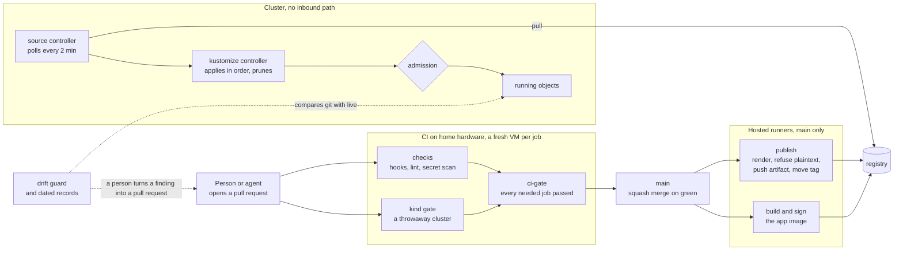

# Academy 0: the big picture





[Academy](academy.html) · module 0 of 13

This module follows one change from the keyboard to the running cluster, and names every part it passes through. Each part has
its own module later. Here the point is the shape of the whole: why there are so many parts, why they are in this order, and
what still sits outside the shape. Every claim carries a date and one of the site's four words: **proven** (seen working on a
live run, with a date), **built** (in place, not seen working under the failure it is for), **planned** or **open**.

## The problem it solves

A cluster changes in many ways. Someone applies a manifest from a laptop. A deploy job pushes a new image. An operator
upgrades itself. A person patches a quota during an incident and forgets it. Each of those is a door, and each door has its
own credential, its own log (or none) and its own idea of what the cluster should look like. After a year, nobody can say
which of them made the cluster what it is.

The previous platform (V1.0, retired on 2026-11-10) lived with that and paid for it. The failures that made the case, all
dated on [the delivery chain](platform.html#v10s-four-stages-to-2026-11-10):

- A setting that fixed a severe incident lived only on the live object, not in git, for 19 days.
- Four monitors applied by hand were lost in a rebuild, which silently switched off the storage alerts.
- On 2026-10-21 a second deploy, run from an older checkout, rolled the cluster back to an old image for two days
  ([the story](how-we-work.html#where-v10-sat-measured-2026-10-27)).

The answer has three parts, and the rest of this page is how they fit:

1. **One door.** A change reaches the cluster only through git. The charter states it as a rule: git is the only way a change
   reaches the platform.
2. **A machine that keeps the door.** Something inside the cluster reads git's state again and again and makes the cluster
   match it, including putting back what a person changed by hand.
3. **Proof instead of trust.** Every step leaves a record that can be read later: a pull request, a check run, a published
   artifact with its commit, a dated run record. A claim that has no record is not a claim.

## How it works

### Two axes: what you write, and who applies it

What you write (declarative end state, or scripted steps) and who applies it (pull from inside, or push from outside) are two
independent questions. [How we work](how-we-work.html#two-axes-what-you-write-and-who-applies-it) has the four cells, the
table and the measurement. The one fact this module needs: only **declarative plus pull** reverts drift as a side effect of
working, and that is where the cluster layer lives. Of about 173 hand-run steps on the previous platform, classified on
2026-10-27, only 19 were declarative applies a controller could own. So the move was "move the declarative layer to pull, and
say plainly what stays a script", not "put everything under a controller".

### Why pull, and not CI pushing

Three reasons, in order of weight.

1. **There is no way in.** The house sits behind carrier-grade NAT: no port forward, no inbound path to the cluster API. A
   build in a hosted runner cannot reach the cluster at all. So the cluster reaches out instead: it fetches what to run from a
   registry on a timer.
2. **The credential stays inside.** In push, the machine that deploys is a cluster-admin machine, and it lives outside the
   cluster where it can be stolen. In pull, the only thing that holds cluster rights is the controller in the cluster. CI ends
   at a signed image and a published artifact; no CI job holds a cluster credential for routine changes (built, read from the
   workflows on 2026-11-11).
3. **Pull has a memory.** A pusher applies once and forgets. A puller applies the same state every few minutes, so a stale
   checkout or a hand patch cannot quietly win. A stale checkout on someone's laptop no longer decides anything: what applies
   is the artifact the moving tag points at, built from a commit on main.

Pull does not make trust disappear. It moves it. In push the thing to protect is the runner and the laptop. In pull it is the
merge right and the artifact: whoever can merge to main, or write the package the controller reads, decides what the cluster
runs. Keep that in mind for the "open" items below.

### What pull does not stop: going backwards

The 2026-10-21 failure was a cluster moving to an older state with nobody meaning it to. Pull removes one way that happens, the
stale checkout. Two ways remain, and nothing orders either (open):

- **The tag can move back.** Rollback, as written in a decision record, is re-running the publish step for an older commit on
  main. That moves the site's tag to an older tree, and the controller applies it like any other. The same run started by
  mistake does the same thing. Old commit tags accumulate in the registry, so the older tree is always there to point at.
- **A digest can move back.** An app version reaches the cluster when a person copies a signed image digest into the tenant
  entry in a pull request. A second pull request that carries an older digest is a valid change: it is signed, it passes the
  gate, and it merges. Nothing compares it with what is running.

Both are visible after the fact (git history, the workflow's runs), which is more than the old platform had. Neither is
refused before it happens. Signing the artifact and pinning it by digest per release are the stated next steps (open).

### The road of one change



Step by step, with what each part is for and what happens when it fails:

1. **The pull request.** Every change, by a person or an AI agent, starts as a branch and a pull request. The description
   carries one line saying which of the platform's objectives the change touches. That line is checked by a workflow that takes
   its script and the list of objectives from the base commit and reads the live description. Since 2026-11-12 the workflow
   file itself comes from the pull request, so a pull request can edit the job that judges it. That is an accepted trade-off
   for a private repository with one author, where the edit shows in the diff (open).
2. **The checks.** Pre-commit hooks run on the laptop and again in CI: a secret scan over the whole history, linters, and the
   repository's own check scripts, each with a self-test that plants the fault it looks for and must go red. A check that has
   only ever been green is not yet evidence it can go red.
3. **The kind gate.** For a change to anything the cluster reads, CI builds a throwaway one-node cluster with kind, installs
   the same admission and tenant rules, publishes the commit's tree to a local registry, and lets Flux apply it. Then it
   asserts behaviour, not status: a hand edit is reverted, an added object appears, a removed object is pruned, an unsigned
   image is refused, the reference app answers its contract, a backup is restored. It is slow: about 31 to 43 minutes at home,
   median about 36, in the 18 green pull-request runs from 2026-11-17 to 2026-11-20 (read from the workflow runs on
   2026-11-20). [Module 1](academy-ci.html) is about where it runs and why.
4. **ci-gate.** One last job that fails if any job this change needed failed, was cancelled or did not run. It exists so that
   a path filter that skips a gate cannot be mistaken for a pass. It is designed to be the one required check. It is
   deliberately **not** required yet (open; see "Proven and not proven").
5. **Merge on green.** Squash merges only, linear history, and the branch must be up to date with main before it merges. That
   last rule is why a push to main runs no checks: the merged tree is exactly the tree the pull request proved.
6. **Publish.** On a merge that touches what the cluster reads, a workflow on a hosted runner takes the tree from the commit
   with `git archive` (never from a working copy), renders every folder the site points at, refuses to go on if any Secret
   file is plaintext (after its own self-test proves it still catches planted plaintext), and pushes the tree as an OCI
   artifact tagged with the commit. Then it moves the site's tag to that artifact. Its only credential is the workflow's own
   token, scoped to write packages. App images are built and signed in a separate job, with a signing key that only main can
   use.
7. **Pull.** In the cluster, the source controller polls the tag every 2 minutes and stores the artifact. The kustomize
   controller applies it as a set of Kustomizations, each re-applied every 5 minutes, with prune on. They depend on each other:
   operators first, then the base, then admission policies, then the load balancer and ingress, then the tenants. Secrets are
   decrypted in the cluster, one unit per namespace. [Module 3](academy-flux.html) covers the order and why it is shaped that
   way.
8. **Admission.** Every pod the controller creates passes the admission engine. A first-party image must carry the CI
   signature, checked against a public key held in the policy in git, with no public transparency log. The signature itself is
   fetched from the registry, so admitting a new pod depends on the registry being reachable. A vendor image must be on a closed list and pinned by digest. A
   tenant namespace has default-deny networking, a quota and the restricted Pod Security level.
9. **Closing the loop.** Flux sees only what git names. An independent drift guard renders git itself, lists what is live, and
   reports what git does not mention: an object made by hand, an object Flux made that git no longer names, an operator whose
   chart version left its pin. Each drill and each proof run writes a dated record with fixed fields: what ran, the result,
   what it proves and what it does not.

### The same change, in time

End to end, the slow part is the proof, not the delivery. The kind gate takes about half an hour or more at home. After the merge, the
publish step takes 18 to 28 s, the source controller notices the new digest within its 2-minute poll, and the Kustomizations
apply in dependency order; merge to running was about 3 to 10 minutes on 2026-11-10/11. Every 5 minutes after that, each
Kustomization applies the same state again, which is what puts a hand edit back.

### When a part fails

The design only counts if each failure has a known behaviour.

| What fails | What happens | How anyone finds out |
| --- | --- | --- |
| A check or the gate goes red | Nothing merges, if the failing check is required. Today only two checks are required, so a red job outside them does not block on its own | The pull request page |
| The home CI hosts are down | There is no hosted fallback. Jobs wait in the queue (up to 24 hours) and nothing merges | The runner liveness alert; alerts for queue age and all hosts down are not built yet (open) |
| The publish step fails | The cluster keeps running the last artifact. Nothing new arrives | The workflow run; no alert |
| The registry or the internet is down | The source controller keeps the last artifact it stored. The kustomize controller keeps applying it, so drift is still reverted to the last known state | Seen on a throwaway cluster on 2026-11-06: about 80 s to notice, and it told nobody. A rule for a source that is not Ready is written now (built), not yet seen firing on a real cut |
| A Kustomization cannot apply | It reports not Ready; those that depend on it wait. Running workloads keep running | A rule fires after 15 minutes not Ready or suspended (built; seen firing on a scratch cluster on 2026-11-11 with its delay cut to one minute, and pending during the power-off drills of 2026-11-19) |
| A pod's image is unsigned or off the list | Admission refuses the pod; the old pods keep serving | The refusal is in the ReplicaSet's events, and the Kustomization goes not Ready when its health check times out (not yet seen on the live site; the kind gate shows the refusal) |
| A person edits a managed object by hand | Put back at the next apply | Flux records an event. The person loses their change |
| A person creates an object git never mentions | Flux does not see it | Only the drift guard, run by hand (two live reads so far) |

A pull system is quiet when it breaks. It keeps doing the last right thing. That is good for the workloads and bad for the
operator, which is why the alerts on the controller itself matter more here than they did with push.

## Our shape

How it is set up here, by role.

- **The cluster.** K3s on six machines: three servers with embedded etcd that also run workloads, and three laptop agents. The
  API is reached through a floating virtual address, never through one node.
- **The controller.** Flux, with only its source and kustomize controllers installed. No Helm controller, no image automation.
  Image automation was left out on purpose: a bot that writes image tags back into git is a second writer.
- **The source.** One OCI artifact in a registry, built from main. A throwaway kind site in CI reads the same tree, so the gate
  rehearses what the live site runs.
- **CI.** Since 2026-11-12 every pull request job runs at home, one fresh VM per job, behind an allow-list proxy, with no
  secret inside and no route to the home network: the kind gate on the two iMac CI hosts, small jobs on those and an old
  laptop. There is no hosted fallback: if the home hosts are down, jobs wait and nothing merges. The few jobs that hold a key or a write token
  (publish, image build and signing) run on hosted runners, on main only.
- **Admission.** Kyverno, with a signature policy for first-party images and a digest-pinned list for vendor images.
- **Secrets.** SOPS with age: ciphertext in git, decrypted by the controller in the cluster.
- **The operator's workstation.** It runs the host playbooks and the first install, and holds a break-glass cluster
  credential. It is not on the routine path: merge, publish and pull all run with it switched off (proven 2026-11-11).

**Portable by layout.** The repository separates what every site runs from what makes a site that site. A check fails if a
site's address or name creeps into the shared core. The aim is that three kinds of site can read the same core: machines we
run, a managed Kubernetes cluster, or a namespace on a hosting platform, where we hold no cluster rights at all. Because CI
never calls a cluster, moving to a new site means pointing a new controller at the artifact, not rewiring a pipeline. The layout
and its check are **built**. Only the home site and the throwaway kind site exist; the other two kinds are **planned**.

### Where the estate still pushes

This is the honest part. The cluster layer is declarative and pull. The edges are not, and the platform is **not fully GitOps
yet**:

| Layer | How it changes today | Why | Status |
| --- | --- | --- | --- |
| Hosts: operating system, firewall, K3s install | Ansible playbooks pushed from the operator's workstation, `--check --diff` first | The pull alternative, a timer on each host running `ansible-pull` from main, is decided in a decision record and not built. It needs a deploy key and an identity per host, and its own stated cost is that a bad merge reaches every host within one interval | playbooks proven 2026-11-10 (six machines); timer **planned** |
| Flux itself and the operators (admission engine, certificate manager, database operator, ingress) | A bootstrap script runs Helm and `flux install`, once | A controller cannot install itself first. The operators were left out of Flux for now | **built**; the script ran once, 2026-11-10. Operator changes since then are hand Helm upgrades from the workstation (for example the database operator's second replica, 2026-11-15) |
| Flux's own version | Whatever the workstation's flux command line installed | Flux does not manage itself here. Its version is pinned nowhere in git; the drift guard prints it and nothing compares it | **open** |
| A handful of objects Flux needs to start: the decryption key, the registry read token, site settings, the load-balancer range, the first source and the root Kustomization | By hand, once | They carry what Flux needs before it can pull | **built**; ran once |
| K3s upgrades | A playbook run from the workstation, one node at a time | On 2026-11-18 it moved the cluster one minor version and passed every gate, and for about two hours the nodes ran a version git did not yet name. The run record says partial: nine minutes after the last gate passed, a pod the gates did not check was crash-looping on a network policy gap, and the host check at the new version did not complete. A decision record proposes upgrade plans in git, applied by Flux through system-upgrade-controller | play ran once, 2026-11-18 (partial); Flux path **planned** |
| The always-on Mac (the ops agent, an alert sender) | Playbook and script, pushed | It is outside the cluster, so Flux cannot reach it | **built**, pushed by design |

One consequence is worth spelling out. A Renovate bump to an operator's chart version lands in git and never reaches the
cluster, because nothing reconciles those charts. The drift guard compares each Helm release with its pin in git, so the gap
can at least be seen.

## How we operate it

**Make a change.** Open a pull request. Do not edit the cluster by hand: Flux reverts managed objects, and the change is lost
along with the time spent on it. This was learned live on 2026-11-10, when quota patches made by hand to unblock a database
during the first bring-up were put back within minutes and the fix had to be redone in git.

**Release an app version.** The image is built and signed on main. Today a person then copies the signed digest into the
tenant entry in a second pull request. That hand-off is manual and nothing orders digests (open). V1.0's "a deploy rolled the
cluster back" lesson has no rule yet on this platform ([going backwards](#what-pull-does-not-stop-going-backwards), above).

**Roll back.** `git revert` the change, merge, wait for publish and the next poll. Flux does not roll back a failed rollout; it
reports not Ready and leaves the decision to a person. The procedure is written and has not been rehearsed on the live site
(open, as of the 2026-11-11 comparison).

**Stop the controller in an incident.** `flux suspend kustomization <name>`, fix in git, then `flux resume`. A suspension is
recorded, and one that must outlast a day is renewed in writing. The not-Ready alert's rule covers suspension (built). On a
scratch cluster on 2026-11-11 it fired for a Kustomization that was suspended and never Ready, with its delay cut to one
minute. A suspension of a Ready Kustomization has not been shown to raise it (open).

**Watch it.** `flux get sources oci -A` shows which artifact revision the cluster holds; `flux get kustomizations -A` shows each
unit's state and the revision it applied. The live count is on the [status page](status.html), not here, because a number
written into prose ages. Alerts reach a chat channel on the owner's phone (the path proven end to end on 2026-11-16, with an
off-site dead-man's switch that noticed a silenced heartbeat in about 10 minutes). Nothing pages through silent mode, waits for
an acknowledgement or escalates (open, by the owner's choice for now).

**Find drift git cannot see.** The drift guard runs read-only against the live site and reports live-only objects, orphans Flux
made, Helm releases off their pins, and any kind it could not read, because "I could not look" must never read as "no drift".

**Rebuild from blank.** On 2026-11-10 six blank machines became a Ready K3s site by playbook, and Flux built everything else from
git, in one supervised session of about four and a half hours from the first merge to the last fix, with three faults found and
fixed in git on the way. It was not one command and not timed from power-on.

**Before a risky change.** Simulate first. Since 2026-11-20 the rule is that no live failure drill runs before its simulation on
a throwaway multi-node cluster has passed (planned: the rule is written; the nightly suite that would enforce it does not
exist yet). [How we work, section 10](how-we-work.html#10-failure-scenarios-simulate-then-pull-the-plug) has the ladder.

## Proven and not proven

**Proven (dated):**

- The pull path: merge, publish, poll, apply, in the publish runs of 2026-11-10 and 2026-11-11 (18 to 28 s each).
- Six blank machines to a running site, supervised, 2026-11-10.
- Secrets decrypted in the cluster from ciphertext in git, 2026-11-10.
- A hand edit put back by Flux on the live site, 2026-11-10. Once, on one object, by accident; not a deliberate test. The kind
  gate tests revert and prune on purpose on every pull request that touches what the site reads.
- The routine path needs no operator machine (2026-11-11).
- The drift guard has read the live site by hand: on 2026-11-11 (no finding, after the allowlist was written) and on
  2026-11-14 (no drift, 631 live objects of 87 kinds). Both runs used an admin credential, not the read-only identity a daily
  job would use.
- The alert path to a person's phone, through chat, once, on 2026-11-16.

**Not proven, with the failures:**

- **The artifact is not signed, and Flux verifies nothing on it.** It is read through a moving tag. Whoever can write that
  package, or merge to main, decides what the cluster runs. Admission checks images, not the artifact. Signing it and verifying
  it in Flux, or pinning a digest, is the stated next step (open).
- **ci-gate is not a required check** (open). On 2026-11-10 a test on a throwaway ruleset showed that after the CI fallback, a
  cancelled run's red result won over a green re-run, and the pull request stayed blocked 28 minutes after the green result
  existed. So two other checks are required, and a red job outside them does not block a merge by itself. The fallback itself
  was removed on 2026-11-12. The check is still not required, and whether that changes is the owner's decision; the test has
  not been re-run against the new setup (open).
- **Merges need 0 approvals.** The owner reads important changes, and a reviewer identity for an agent is planned. Branch
  protection on main itself has never been tested by a refused merge; a throwaway ruleset was.
- **The drift guard is not scheduled.** Two live reads by hand, no daily job with an alert yet (built, not proven as a daily guard).
  V1.0's daily guard ran red from 2026-11-02 to 2026-11-09 and nobody read it, so a guard without delivery is worth little.
- **Renovate is configured and has not been seen acting** (built). Until it opens pull requests, version bumps are a person.
- **The edges are pushed** (hosts, bootstrap, operators, K3s upgrades): the table above.
- **The kind gate fails for its own reasons too.** On 2026-11-09 five gate runs in 83 minutes, on two branches, gave one green
  and four reds in four different places (the backup drill, a latency check, the fuzz test, the site build). The backup drill's
  red was put down, from the logs and not proved, to a race in the gate's own script, which was then changed. Each needed its own diagnosis, and a re-run is
  not a diagnosis.
- **Losing the source is quiet.** Seen on a throwaway cluster on 2026-11-06; the rule that should catch it is not yet seen
  firing on a real cut.

**The proof culture, in four rules.** A claim lands as a measurement, with a date. A failed run gets a record too, and a record
is never edited to turn a fail into a pass. A test counts only once it has been seen to fail on purpose. And a referee that is
read after the decision is not a referee: on 2026-11-20 a step was merged in the same command that read the previous step's
referee, and the rule became "read the referee, then merge".

## Try it yourself

Build the same loop on a laptop: a cluster that pulls an OCI artifact made from a git commit, reverts a hand edit, prunes a
removed object, and keeps going when its source disappears. You need Docker, [kind](https://kind.sigs.k8s.io/), `kubectl`,
`git` and the [flux command line](https://fluxcd.io/flux/installation/). k3d works too; use its network name (`k3d-academy`)
in place of `kind` in steps 1 and 7. About 20
minutes.

**1. A cluster, a registry it can reach, and Flux with the same two controllers as here.**

```bash
kind create cluster --name academy
docker run -d --name ocistore -p 5000:5000 registry:2
docker network connect kind ocistore   # pods reach it by container name
flux install --components=source-controller,kustomize-controller
```

**2. A tiny site in git.**

```bash
mkdir academy-demo && cd academy-demo && git init -q
mkdir site
cat > site/kustomization.yaml <<'EOF'
apiVersion: kustomize.config.k8s.io/v1beta1
kind: Kustomization
resources: [namespace.yaml, settings.yaml]
EOF
cat > site/namespace.yaml <<'EOF'
apiVersion: v1
kind: Namespace
metadata: {name: demo}
EOF
cat > site/settings.yaml <<'EOF'
apiVersion: v1
kind: ConfigMap
metadata: {name: settings, namespace: demo}
data: {greeting: hello from git}
EOF
git add . && git commit -qm "first state"
```

**3. A publish step that ships only what is committed**, as the real one does with `git archive`.

```bash
publish() {
  out="$(mktemp -d)"
  git archive HEAD site | tar -x -C "$out"
  sha="$(git rev-parse HEAD)"
  flux push artifact "oci://localhost:5000/demo/site:${sha:0:12}" \
    --path="$out" --source=local --revision="main@sha1:$sha"
  flux tag artifact "oci://localhost:5000/demo/site:${sha:0:12}" --tag live
}
publish
```

**4. Tell the cluster where to pull from.** This is the one hand step, like the bootstrap objects above.

```bash
kubectl apply -f - <<'EOF'
apiVersion: source.toolkit.fluxcd.io/v1
kind: OCIRepository
metadata: {name: demo, namespace: flux-system}
spec:
  interval: 1m
  url: oci://ocistore:5000/demo/site
  ref: {tag: live}
  insecure: true
---
apiVersion: kustomize.toolkit.fluxcd.io/v1
kind: Kustomization
metadata: {name: demo, namespace: flux-system}
spec:
  interval: 2m
  sourceRef: {kind: OCIRepository, name: demo}
  path: ./site
  prune: true
  wait: true
  timeout: 2m
EOF
flux reconcile kustomization demo -n flux-system --with-source   # waits for the first apply
flux get sources oci -A && flux get kustomizations -A
kubectl -n demo get configmap settings -o jsonpath='{.data.greeting}{"\n"}'
```

**5. Drift is reverted.** Edit by hand, then let the controller run (or wait two minutes).

```bash
kubectl -n demo patch configmap settings --type merge -p '{"data":{"greeting":"hand edit"}}'
flux reconcile kustomization demo -n flux-system
kubectl -n demo get configmap settings -o jsonpath='{.data.greeting}{"\n"}'   # hello from git
```

**6. An uncommitted change goes nowhere; a committed one arrives; a removed one is pruned.**

```bash
sed -i.bak 's/hello from git/second version/' site/settings.yaml && rm site/settings.yaml.bak
publish && flux reconcile kustomization demo -n flux-system --with-source
kubectl -n demo get configmap settings -o jsonpath='{.data.greeting}{"\n"}'   # still hello from git
git commit -qam "second state" && publish
flux reconcile kustomization demo -n flux-system --with-source
kubectl -n demo get configmap settings -o jsonpath='{.data.greeting}{"\n"}'   # second version, now committed
kubectl -n demo create configmap extra --from-literal=a=b --dry-run=client -o yaml > site/extra.yaml
sed -i.bak 's/resources: \[/resources: [extra.yaml, /' site/kustomization.yaml && rm site/kustomization.yaml.bak
git add . && git commit -qm "add extra" && publish
flux reconcile kustomization demo -n flux-system --with-source && kubectl -n demo get configmap
git rm -q site/extra.yaml && sed -i.bak 's/extra.yaml, //' site/kustomization.yaml && rm site/kustomization.yaml.bak
git commit -qam "remove extra" && publish
flux reconcile kustomization demo -n flux-system --with-source && kubectl -n demo get configmap   # extra is gone
```

**7. Cut the source and watch it stay quiet.**

```bash
docker network disconnect kind ocistore
flux reconcile source oci demo -n flux-system        # fails
kubectl -n demo patch configmap settings --type merge -p '{"data":{"greeting":"hand edit"}}'
flux reconcile kustomization demo -n flux-system     # still reverted, from the last stored artifact
flux get sources oci -A                              # Ready False, and nobody was told
docker network connect kind ocistore
```

Questions to answer for yourself: what in this setup would tell a person that step 7 happened? Who, in your version, can move
the `live` tag, and what stops them? What does the cluster run if two people publish within a minute of each other?

**Clean up:** `kind delete cluster --name academy && docker rm -f ocistore`.

## Further reading

**The learning path.** The modules follow the change in this page's order:

1. [CI at home](academy-ci.html): one fresh VM per job, the two pools, the gate, merge on green.
2. Supply chain: SBOMs, the scan and its triage, signing, the signature checked again at admission (planned).
3. [Flux and GitOps](academy-flux.html): the artifact, Kustomizations in order, drift, what Flux does not own.
4. The K3s cluster: servers and embedded etcd, the API's virtual address, upgrades node by node (planned).
5. Network and DNS: the pod network, default-deny, DNS on every node and the 51-second stall (planned).
6. Admission: policies, audit before refuse, policy reports (planned).
7. Data: the Postgres operator, poolers, backups and their copies, restore drills (planned).
8. Identity: the login service, its database, sessions across replicas (planned).
9. Observability: metrics, alerts, logs, traces, probes, the heartbeat (planned).
10. Secrets: SOPS and age, key custody, rotation (planned).
11. Breaking it on purpose: simulate first, then power-off drills, and records as proof (planned).
12. AI in operations: the analyst, the reviewer, evaluation, what stays local (planned).

The full list with its state is on the [Academy](academy.html) page.

**On this site.**

- [The delivery chain](platform.html): the same path with V1.0's history and the app contract.
- [How we work](how-we-work.html): the rules, approvals, home CI, restore drills and the failures, dated.
- [DevSecOps, end to end](devsecops.html): every gate from commit to pod, and what each proves.
- [High availability, audited](reliability.html): the single points and the drills against them.
- [Status](status.html): the live counts, generated.

**The projects' own documentation.**

- OpenGitOps principles: <https://opengitops.dev/>
- Flux OCI repositories: <https://fluxcd.io/flux/components/source/ocirepositories/>
- Flux Kustomizations, dependencies and pruning: <https://fluxcd.io/flux/components/kustomize/kustomizations/>
- Flux with OCI artifacts: <https://fluxcd.io/flux/cheatsheets/oci-artifacts/>
- Flux SOPS integration: <https://fluxcd.io/flux/guides/mozilla-sops/>
- kind: <https://kind.sigs.k8s.io/docs/user/quick-start/>
- k3d: <https://k3d.io/>
- K3s automated upgrades: <https://docs.k3s.io/upgrades/automated>
- Kyverno image verification: <https://kyverno.io/docs/>
- cosign: <https://docs.sigstore.dev/cosign/signing/overview/>
- ansible-pull: <https://docs.ansible.com/ansible/latest/cli/ansible-pull.html>
- GitHub Actions self-hosted runners: <https://docs.github.com/en/actions/hosting-your-own-runners>
- Renovate: <https://docs.renovatebot.com/>

<script type="module">
  import mermaid from 'https://cdn.jsdelivr.net/npm/mermaid@11/dist/mermaid.esm.min.mjs';
  mermaid.initialize({ startOnLoad: false, theme: 'neutral' });
  document.querySelectorAll('pre > code.language-mermaid').forEach((el) => {
    const div = document.createElement('div');
    div.className = 'mermaid';
    div.textContent = el.textContent;
    el.parentElement.replaceWith(div);
  });
  mermaid.run();
</script>
