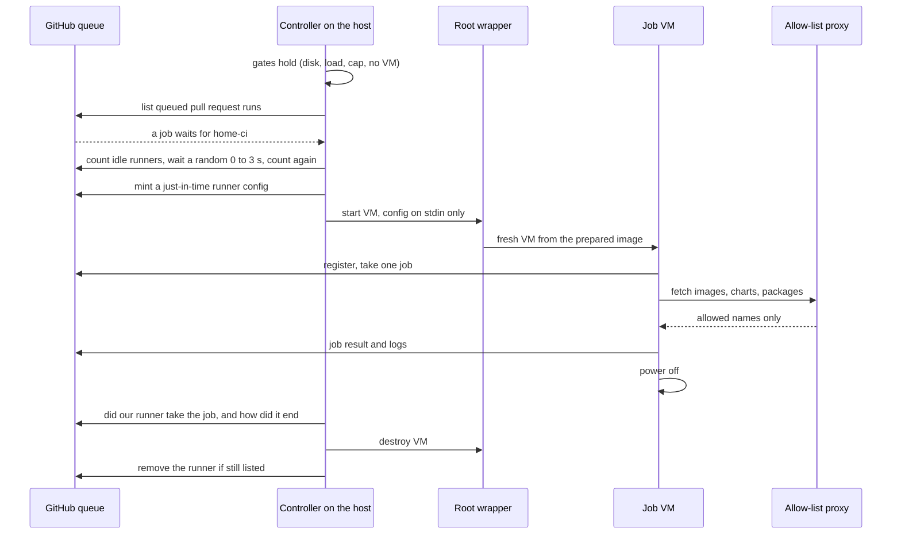
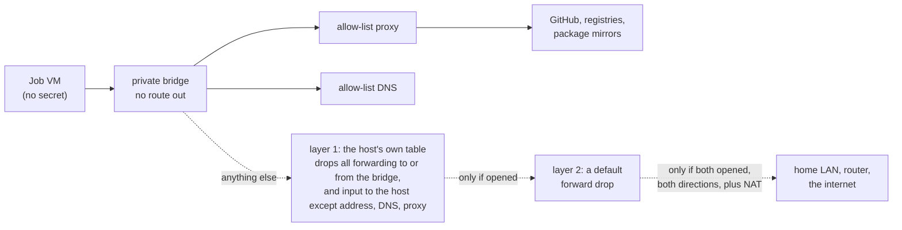

# Academy 1: CI at home





[Academy](academy.html) · module 1 of 13

This module explains how pull request CI runs on two old desktop machines in a house, and what it took to make that safe and boring. It goes deeper than the short accounts in [How we work, section 6](how-we-work.html#6-home-ci) and [Where CI runs](platform.html#where-ci-runs). Those two pages describe the state of 2026-11-10 and 2026-11-11: until 2026-11-12 a route job sent work home only when a host was idle, and a watchdog fell back to hosted runners. Both were removed on 2026-11-12, when every pull request job moved home. Every claim here carries a date and one of the site's four words: **proven**, **built**, **planned**, **open**.

## The problem it solves

A pull request on this platform starts several jobs: a bundle of small checks, an objectives check, an aggregate gate, and sometimes a build of the reference app and a kind gate. The kind gate builds a whole throwaway cluster, installs the platform into it and tests it end to end. It is the heavy one.

This account's plan includes 3,000 hosted Linux minutes a month; each minute above that costs $0.006. By 2026-11-09, day nine of the month, 2,685 were used, and the kind gate alone was 49% of that. On 2026-11-11 the month stood at 4,528. On 2026-11-12 it stood at 6,398, the $20 spending limit was used up, and every hosted job began to fail in one second. A failed hosted job also means a failed required check, so nothing could merge.

So the problem has three parts:

1. **Cost.** Run the jobs somewhere that does not bill per minute.
2. **Safety.** A CI job runs whatever the pull request says. Running it on a machine in the house must not give it the house network, the router, or any credential.
3. **Availability.** The old platform once lost 11 days of CI when hosted jobs were refused. The new path must keep working, and say clearly when it does not.

Speed is not one of the goals. The kind gate takes 26 to 40 minutes at home (median 36.8) against roughly 10 to 27 minutes hosted, depending on the month and the size of the gate. The case for home CI is saved minutes, not time.

## How it works

### The moving parts

| Part | Where it runs | What it does |
| --- | --- | --- |
| The controller | A small program on each CI host, run by a service account that may call one wrapper and nothing else | Watches the queue, starts one VM per job, supervises it, writes a heartbeat |
| The wrapper | Root-owned script on the host | Starts, lists and destroys job VMs. The only privileged thing the controller can do |
| The job VM | Incus virtual machine, from a prepared image | Runs one GitHub Actions job, then powers off |
| The prepared image | Built on each host by the playbook | The runner, Docker, kind, kubectl, Helm, Java, Maven settings with the proxy, the proxy settings for kind's nodes |
| The private bridge | Host networking | The VM's only network. No route to the LAN or the internet |
| The allow-list proxy | Squid, on the bridge address | Lets the VM reach a named list of hosts over HTTPS, refuses the rest, logs every refusal |
| The allow-list DNS | On the bridge address | Answers for the allowed names and anything under them, and for the whole parent domains of the blob-store patterns. The proxy, not the DNS, decides what is reached |
| The heartbeat | A repository variable per host | `<UTC time> <state>`, written once a minute |
| The liveness alert | A probe on an always-on machine outside the hosts | Meant to raise an alert when a controller is dead, hung or silent. Its target was retired on 2026-11-10, so today it reaches nobody (**open**, see below) |

### One job, start to finish

The controller polls every 30 seconds. Before it looks at the queue it checks its own gates: not disabled, not paused, not cooling down, under its cap of VM starts an hour, no job VM already running, at least 15% of the disk free, load at most 6. Only when all of them hold does it read the queue, and only then may its heartbeat say `free`.



A few details in that sequence carry most of the safety:

- **The just-in-time runner configuration** is minted by the controller with a token the VM never sees. It is passed to the wrapper on standard input, never as an argument and never in a log. It registers a runner that takes exactly one job and is spent by registration. So the only credential in the VM is one that is already used up.
- **GitHub's record decides the outcome**, not the VM's lifetime. If the controller's runner took the job and it completed, that is a success. If the job was cancelled or taken by another runner, that is neutral. If the VM powered off while its job was still queued, that is a failure. Guessing from how long the VM lived would make a fast job or a cancelled one look like a fault.
- **A failure cools the host down** for 2 minutes. Three failures in a row pause it, first for 60 seconds, then doubling up to 4 hours. Only a job that ran resets the count. This is the circuit breaker that stops a broken image from burning through the queue.
- **Every job has a ceiling.** The controller ends a VM after 90 minutes, below the wrapper's own reaper timer, so a hung job is never counted as a success. Each workflow job also carries its own lower `timeout-minutes`.

### The network: two layers, either one enough



The VM has an address on a bridge that the host does not route. The host's own firewall table drops all forwarding from and to the bridge, whatever the destination, and drops anything the VM sends to the host itself except a DHCP request, a DNS query and the proxy. A second, independent layer, a default drop on forwarding, stands behind it for every destination too. On the predecessor host, broken on purpose, either layer alone held.

The proxy matches exact names, a small number of suffixes and a few narrow patterns for the blob stores that registries redirect to. Each suffix and pattern has a written reason, because each is a wider hole. The patterns are the honest weak point: anyone who can create a storage bucket whose name fits one could receive data from a job. Job code holds no secret, but it does see the private repository.

**What the host holds.** The VM holds no credential, but the host does. The controller's registration token has repository administration rights, because minting and deleting runners needs them, and that also lets it change branch protection. So the host, not the VM, is the asset to protect. The token is scoped to one repository and expires after 90 days. Separately, anyone who can push a branch can make a host pause itself with three failing jobs. The cost is queue time, not a merge.

### Two pools and host priority

The kind gate is the one big job. It needs a 6 vCPU, 10 GiB VM. The small jobs (the checks bundle, the app build, the objectives check, the aggregate gate) need far less. So jobs come in two pools:

| Pool | Labels the job asks for | Which hosts serve it |
| --- | --- | --- |
| small | `self-hosted, linux, x64, home-ci` | every host |
| gate | the same, plus `home-gate` | only hosts big enough for the gate |

A gate runner's labels are a superset of the small ones, so a spare gate runner can take a small job. The reverse never happens. This has one accepted weakness: a gate runner that registers while a small job is queued may be handed the small job. The gate then waits for the next pick. It heals itself and costs at most one small job's time.

Host priority decides who takes a job when several hosts are free. Each host has a number, 0 first. A host with a higher number that sees a job waits while a lower-numbered host that serves the job's pool reads `free` in a heartbeat at most 150 seconds old. It waits for at most 90 seconds. After that it takes the job whatever the others say, so a slow host never starves a job. Anything other than a fresh `free` (busy, paused, stale, unreadable) counts as not free, and the job is taken at once.

### Several hosts, one queue

Two or more controllers (three today: the two iMacs and the spare laptop) watch one queue. Without care, each would start a VM for every queued job. Two guards prevent that:

1. **The claim rule.** Before starting a VM, a controller counts the runners already waiting for a home job on any host, and starts only when more jobs are queued than that. It waits a random part of 3 seconds and counts again.
2. **The surplus guard.** In its first 120 seconds, a VM orders the idle runners by the time they were minted. If it stands beyond the number of queued jobs, on two polls in a row, it deletes itself. The later duplicate leaves, the earlier one runs the job.

The second guard exists because the first one failed in live use (below).

### The workflow side

Every routed job reads one expression: `fromJSON(vars.CI_RUNS_ON || '["self-hosted","linux","x64","home-ci"]')`. Setting the repository variable `CI_RUNS_ON` to `"ubuntu-latest"` sends the routed jobs to hosted runners. It is a manual switch, not an automatic fallback. With no hosted minutes left, a flipped job fails in one second and bills nothing. The kind gate has its own variable that falls back to the first one.

Jobs that hold a key or a write token never go home and never read the switch. They run hosted, on a push to main or on a schedule. The image signing job runs in a protected environment that only the main branch may use, and its condition is a second lock: a pull request never starts it. A checking script fails the build if a routed job gains a secret, a write token, an environment, a cache, or a call to a workflow outside the repository.

At the end of every pull request run, an aggregate job named `ci-gate` needs every other job. It runs `always()`, so a cancelled run leaves a red `ci-gate` behind, because GitHub counts a skipped required check as passed. A path-filtered gate that was not needed may be skipped; anything needed must be green.

## Our shape

- **Two iMac CI hosts** from 2013, each with 8 threads, about 15 GB of RAM and a SATA SSD, running Ubuntu with a ZFS root and Incus. Both serve both pools, both have priority 0. One job VM at a time each.
- **An old laptop as a small-only spare**, with 4 threads and a smaller VM (3 vCPU, 8 GiB). Priority 1, so it waits up to 90 seconds for a free iMac. It has never completed a kind gate, so it does not serve the gate pool.
- **Hosted runners** for the few jobs that hold a key or a write token: building and signing the reference app's image and publishing the site on a push to main, and a weekly scheduled upstream check.
- **The liveness probe** on an always-on machine that is not a CI host. It reaches each host through an SSH key forced to one read-only probe command.
- **Main's protection**, read on 2026-11-20: two required checks (the checks bundle and the objectives line), linear history, and branches must be up to date before merge. The protection binds admins, so a merge without green required checks is refused for everyone. The repository allows only squash merges. Because a branch must be up to date, a push to main runs no check: the merged tree is the tree the pull request proved. If that setting were turned off, a check after merge would be needed.
- **The cost guard**: a check fails any job without `timeout-minutes` or with one above 60 minutes (85 for the kind gate's job, the one named exception), and any pull request workflow where a newer push does not cancel the older run. A $20 spending limit was set on 2026-11-09. On 2026-11-12 hosted jobs began to fail once about $20 of overage was used, which suggests the limit stops spend; the exact stop point and its alerts are not verified.

A pull request costs 3 VM starts if it changes only documentation, 4 with the kind gate, 5 with the app build too. A draft pull request skips the kind gate; marking it ready starts the gate once.

## How we operate it

### Change it through the playbook, never by hand

Everything on a CI host comes from one Ansible playbook, one variables file and the inventory in git: packages, the bridge, the firewall, the proxy and its allow-list, the DNS, the image, the wrapper, the controller and its settings. Per-host pools and priority live in the inventory. A change is a pull request, then a dry run with `--check --diff` that someone reads, then the apply, one host at a time and only when that host is idle. Agents do not apply; the owner does, by hand. Nothing yet checks a host for drift from git (**open**), so "the host matches git" holds only as well as that discipline.

Two reasons for the discipline, one learned and one foreseen. First, a host that was edited by hand cannot be rebuilt from git, and the second host is built from the same play. Second, the order of hosts matters. When the gate pool was introduced, a host still running the older controller would have claimed gate jobs with small runners that could never take them, holding its only VM slot until the idle rule ended it. So the procedure required both iMacs to be applied back to back before any pull request asked for the new label. All three hosts were applied on 2026-11-12.

The allow-list is found from the proxy log, not guessed. When a new tool enters the checks, the first run shows a refusal in the log, the name goes into the variables file in git, and the proxy and DNS parts of the play are applied again. On 2026-11-12, the first all-home run found that a linter hook needed two package hosts. The first kind gate runs in a VM found more refused names, one round at a time, before the list was right.

### The handover: two controllers must never run at once on one identity

A new host is created with a disable file in place. The script that copies the controller's tokens to it refuses a target without that file. A handover script disables the old host, then enables the new one, and can roll back. Since each host writes its own heartbeat variable (2026-11-11), several hosts can run at once, but only after the per-host code is applied to all of them. On 2026-11-11 the per-host code was merged but not applied: enabling the second host as it was would have made two controllers fight over one variable and start two VMs per job. The code was applied first.

To stop a host, touch its disable file. No new VM starts; a running job finishes. To stop everything, disable every host: jobs wait in the queue, which costs nothing, and GitHub keeps a queued job for 24 hours.

### Watch it: read the heartbeat before you call a host dead

| State | Means | New jobs |
| --- | --- | --- |
| `free` | every gate held, queue and runner list readable | taken at once |
| `busy` | a job VM exists or is being cleaned up | wait |
| `cooldown` | 2 minutes after a failure, or at the hourly cap | wait |
| `paused` | three failures in a row | wait |
| `disabled` | the disable file exists | wait |
| `withheld` | a gate it cannot clear or read (a unit down, the disk, the load, an expired token) | wait |

A time that stops moving means dead or hung, whatever the last word was. When a pull request waits, compare the queue with the heartbeats. A queued run older than 15 minutes while a host reads a fresh `free` is a bug in the claim rule, the cap or a label. With a stale or non-free heartbeat it is a host problem, and the controller's journal on that host says why. Until the alert reaches someone again, this reading by hand is the only watch.

### What breaks, and how we recover

- **A run stuck in `pending`.** The controller reads runs that are `queued` or `in_progress`. A new run of a pull request can sit in `pending` while an older run of the same concurrency group is still cancelling, with every host free. Cancel the older run and the pending one moves within a minute. Do not push to a branch while its run is in progress: each push restarts that wait, and a gate lost half way costs 25 to 50 minutes.
- **Stale red checks on a commit.** After cancelled runs and a close and reopen, a commit carried a cancelled checks run and a failed `ci-gate` beside later green ones. The rollup said failure and the merge was refused. A new commit gives a clean set. Better: let a run finish.
- **An expired token.** The controller's two tokens are fine-grained, scoped to one repository, and expire after 90 days. The service reads them at start. Replace the file and restart the unit, or every queue read fails, the heartbeat says `withheld`, and every job waits.
- **A reboot.** Incus starts on demand, so after a kernel update the bridge did not exist and the proxy and DNS restarted for ever. Both units now want Incus first. After any reboot, check that Incus, the proxy and the DNS are active.
- **A host that is down for long and was the only gate host.** A variable can let any host take the gate. It is the escape hatch, and it is deleted again afterwards.

### The lessons, each paid for once

- **A heartbeat that goes quiet while busy looks dead.** The first controller wrote its heartbeat only while free. During a 26-minute job its age read 1,588 seconds, and the log said what a dead host says. Now it writes the time and the state every minute, `busy` included. Read the state before you call a box dead.
- **The host firewall's default-deny dropped the job bridge.** With `ufw` active, the VM received 0 packets: no DHCP, no DNS, no proxy. The play now opens exactly those three on the bridge, and nothing else.
- **A slow disk.** The first spike host, which did not use ZFS, took 146 ms for one synced 4 KB write (measured 2026-11-09; a healthy SSD takes about 0.1 ms), so a VM unpacking images ran 13 synced writes a second. Telling QEMU not to pass flushes on (`io.cache: unsafe`) took 2,000 synced writes from 149 s to 0.7 s. That is right only for a VM deleted after one job.
- **On ZFS that setting clashes.** The VM disk needs ZFS block mode, and `io.cache: unsafe` cannot be combined with it. So on ZFS the profile drops the setting and the play disables sync on the one dataset that holds the VMs instead: the same trade, held to throwaway disks.
- **Every wait has a bound.** An unbounded wait for the image build's first boot once waited 16 minutes for an agent that was never installed. Now the build waits at most 6 minutes and says why, a smoke test fails in 90 seconds, the gate's internal waits are ceilings sized for the slowest host (each returns the moment the thing is ready), every job has a timeout, and the controller has its 90-minute ceiling.
- **A dry run cannot see a missing directory.** A dry run passed, and the real run failed because a configuration directory did not exist. After a dry run, apply to a test host before trusting a new task.
- **Fast jobs are not failures.** A 5-second job other than the one a VM was started for can start and finish between two polls. That was logged as a failure, and three in a row paused a host. Now the controller asks GitHub whether the VM's runner ran any job before it calls a failure.

## Proven and not proven

| Claim | Status |
| --- | --- |
| A job VM cannot reach the LAN, the router or the internet directly | **proven** 2026-11-09 on the predecessor spike host, by breaking it on purpose: the probe went red only when both firewall layers were opened, in both directions, with a hand-made masquerade. Either layer alone held. There the second layer was a container engine's default forward drop. IPv6 paths in a broken state were not tested. The current two hosts carry the same host table (**built**); their second layer is not documented and no break test has run on them (**open**) |
| The real kind gate passes at home through the controller | **proven** 2026-11-10 on a throwaway pull request, on the third attempt. The two reds were flakes in the gate itself, each fixed. 32 min 20 s, 1.2 to 1.35 times a hosted run that month |
| The liveness alert fires on a stopped controller and clears | **proven** once, 2026-11-10: active about 3 minutes after the stop, cleared after the start, against the old cluster's alert manager. That alert manager was retired the same day. A new delivery path is **built**, but the installed copy of the probe has not been updated to use it, so today a dead host raises nothing that reaches anyone (**open**). That a message ever reached a person was not seen, and the hung and unreachable paths are self-tests only |
| Which aggregate gate result a merge reads after a cancelled run | **proven** 2026-11-10 on a throwaway ruleset: after a run was cancelled and its job re-run as a separate dispatched run, the cancelled run's red `ci-gate` blocked the merge. The dispatched run's green never reached the pull request, which stayed blocked 28 minutes after it existed. A full re-run of the original run cleared it. The fallback that caused this was removed on 2026-11-12. `ci-gate` is still not a required check (**open**) |
| Two hosts take jobs at once | **proven** 2026-11-11: two VMs ran in parallel, one per host |
| The claim rule prevents a double start | **open**: failed in live use on 2026-11-11. Two hosts started a VM for one job 7 seconds apart, because the runner list had not yet shown the first host's fresh runner. Cost: one host's capacity for a job's length, no wrong result. The surplus guard was written for it and is **built**, proven against fakes only. How long the list really lags is not measured |
| The controller's logic | **built**: a self-test against fakes, and a mutation test that breaks the controller 221 ways; all 221 are caught |
| Every pull request job at home | **proven** in daily use since 2026-11-12 |
| Host priority sends work to the iMacs first | **built**, applied 2026-11-12. No journal evidence of the waiting rule is on record yet |
| The laptop as overflow | **built**, measured 2026-11-17: the checks job took 18 to 21 minutes on an iMac and 33 on average on the laptop. Three of six laptop runs hit the old 35-minute limit and were cancelled; the limit is now 50 |
| A kind gate on the laptop | **open**: never completed; a measured experiment is written down, not run |
| A host failing mid-job is picked up by another | **open**: not tested |
| Hosts match git | **open**: applied by hand; no drift check exists |
| A queue-age alert | **open**: until it exists, a backlog is watched by hand |
| The stream gate at home | **open**: it failed at home on 2026-11-19 on the app's CPU limit; it runs as advisory since 2026-11-20 and does not block |

**Read 2026-11-20, from GitHub's job times for 2026-11-16 to 2026-11-20.** This is a reading in a plan entry, not yet a dated record of its own. 470 jobs ran at home. The iMacs were busy 32% and 30% of the time, the laptop 13%. For the jobs that wait on no other job (the checks bundle, the objectives check, the kind gate), the median wait from queued to started was 1.2 minutes, mostly the fresh VM starting. The 90th percentile was 5.5 minutes for the checks bundle and 8.4 for the gate. 41 jobs waited more than 5 minutes, the worst 115. 18 of those 41 waited while a host was free: a pickup fault, not a lack of capacity (**open**: found 2026-11-20, nothing built yet). Two full-size job VMs (6 vCPU, 10 GiB each) do not fit on one 8-thread, 15 GB iMac, so a second, smaller slot per host for small jobs is **planned**, after the small VM size is measured. The checks job needs about 2 CPU and 4 GiB.

What none of this proves: that home CI is as fast as hosted (it is not), or that it survives every host being down (jobs queue for up to 24 hours, by design).

## Try it yourself

You can build the core idea, a throwaway job that can reach the outside world only through an allow-list proxy, on a laptop in about ten minutes. This uses [k3d](https://k3d.io/), because the K3s it runs enforces Kubernetes NetworkPolicy out of the box. A pod is a weaker boundary than a VM (it shares the host's kernel), which is exactly why the real setup uses a VM and two firewall layers. The shape of the test is the same.

**1. A cluster, and a proxy with an allow-list of two names.**

```sh
k3d cluster create academy-ci --agents 0 --wait
kubectl create namespace egress
kubectl create namespace job
kubectl apply -f - <<'EOF'
apiVersion: v1
kind: ConfigMap
metadata: {name: squid, namespace: egress}
data:
  squid.conf: |
    http_port 3128
    acl allowed dstdomain api.github.com github.com
    acl SSL_ports port 443
    acl CONNECT method CONNECT
    http_access deny CONNECT !SSL_ports
    http_access allow allowed
    http_access deny all
    access_log daemon:/var/log/squid/access.log squid
---
apiVersion: apps/v1
kind: Deployment
metadata: {name: squid, namespace: egress}
spec:
  selector: {matchLabels: {app: squid}}
  template:
    metadata: {labels: {app: squid}}
    spec:
      containers:
        - name: squid
          image: ubuntu/squid
          ports: [{containerPort: 3128}]
          volumeMounts: [{name: conf, mountPath: /etc/squid/squid.conf, subPath: squid.conf}]
      volumes: [{name: conf, configMap: {name: squid}}]
---
apiVersion: v1
kind: Service
metadata: {name: squid, namespace: egress}
spec:
  selector: {app: squid}
  ports: [{port: 3128, targetPort: 3128}]
EOF
kubectl -n egress rollout status deploy/squid --timeout=180s
```

**2. The job's namespace may talk to the proxy and to cluster DNS, and nothing else.**

```sh
kubectl apply -f - <<'EOF'
apiVersion: networking.k8s.io/v1
kind: NetworkPolicy
metadata: {name: job-egress, namespace: job}
spec:
  podSelector: {}
  policyTypes: [Egress]
  egress:
    - to:
        - namespaceSelector: {matchLabels: {kubernetes.io/metadata.name: egress}}
          podSelector: {matchLabels: {app: squid}}
      ports: [{protocol: TCP, port: 3128}]
    - to:
        - namespaceSelector: {matchLabels: {kubernetes.io/metadata.name: kube-system}}
          podSelector: {matchLabels: {k8s-app: kube-dns}}
      ports: [{protocol: UDP, port: 53}, {protocol: TCP, port: 53}]
EOF
```

**3. A fresh, throwaway "job" that probes three paths.** It sleeps 5 seconds first. On K3s' built-in policy engine a new pod is not yet under its policy for about 1 to 3 seconds after it starts (measured on this estate on 2026-11-10). A probe in that window can say `ok` with the policy in place. That gap is itself a real limit of pod-level isolation.

```sh
probe() {
  kubectl -n job delete pod probe --ignore-not-found --wait
  kubectl -n job run probe --image=curlimages/curl --restart=Never --command -- sh -c '
    sleep 5
    P=http://squid.egress.svc.cluster.local:3128
    curl -sS -m 10 -o /dev/null -x $P https://api.github.com/ && echo "allowed name, via proxy: ok"  || echo "allowed name, via proxy: refused"
    curl -sS -m 10 -o /dev/null -x $P https://example.com/    && echo "other name, via proxy: ok"    || echo "other name, via proxy: refused"
    curl -sS -m 10 -o /dev/null       https://example.com/    && echo "direct, no proxy: ok"         || echo "direct, no proxy: refused"'
  kubectl -n job wait --for=jsonpath='{.status.phase}'=Succeeded pod/probe --timeout=120s
  kubectl -n job logs probe | grep -E ': (ok|refused)$'
}
probe
```

Expect `ok`, `refused`, `refused`. Then read the proxy's log the way the real allow-list is maintained: `kubectl -n egress exec deploy/squid -- grep DENIED /var/log/squid/access.log`.

**4. Break it on purpose.** A check that has never gone red is not evidence yet.

```sh
kubectl -n job delete networkpolicy job-egress
probe            # the last line should now say "direct, no proxy: ok": the check can fail
```

Put the policy back (rerun step 2) and probe again. Then clean up with `k3d cluster delete academy-ci`.

**Going further.** The real setup's other half is a runner that takes exactly one job. With a throwaway repository of your own, GitHub's REST API can mint a just-in-time runner configuration (`POST /repos/{owner}/{repo}/actions/runners/generate-jitconfig`), and the runner started with it takes one job and is removed. Treat that configuration as a credential until it is spent, remember that the token which mints it can administer the repository, and never run a self-hosted runner for a public repository that strangers can send pull requests to.

## Further reading

- GitHub Actions: [self-hosted runners](https://docs.github.com/en/actions/hosting-your-own-runners/managing-self-hosted-runners/about-self-hosted-runners), [ephemeral and just-in-time runners for autoscaling](https://docs.github.com/en/actions/hosting-your-own-runners/managing-self-hosted-runners/autoscaling-with-self-hosted-runners), [the runners REST API](https://docs.github.com/en/rest/actions/self-hosted-runners), [concurrency](https://docs.github.com/en/actions/writing-workflows/choosing-what-your-workflow-does/control-the-concurrency-of-workflows-and-jobs), [environments](https://docs.github.com/en/actions/managing-workflow-runs-and-deployments/managing-deployments/managing-environments-for-deployment), [billing for Actions](https://docs.github.com/en/billing/managing-billing-for-your-products/managing-billing-for-github-actions/about-billing-for-github-actions)
- [Incus documentation](https://linuxcontainers.org/incus/docs/main/), including VMs, profiles and bridged networks
- [Squid documentation](https://www.squid-cache.org/Doc/) for access control lists
- [Ansible documentation](https://docs.ansible.com/), especially check mode and diff mode
- [OpenZFS documentation](https://openzfs.github.io/openzfs-docs/)
- [kind](https://kind.sigs.k8s.io/), [k3d](https://k3d.io/), and [Kubernetes NetworkPolicy](https://kubernetes.io/docs/concepts/services-networking/network-policies/)
- On this site: [How we work, home CI](how-we-work.html#6-home-ci), [the delivery chain and where CI runs](platform.html#where-ci-runs) (both describe the state before 2026-11-12), [DevSecOps, the whole chain](devsecops.html), [high availability, audited](reliability.html), [what I'd do differently](lessons.html)

<script type="module">
  import mermaid from 'https://cdn.jsdelivr.net/npm/mermaid@11/dist/mermaid.esm.min.mjs';
  mermaid.initialize({ startOnLoad: false, theme: 'neutral' });
  document.querySelectorAll('pre > code.language-mermaid').forEach((el) => {
    const div = document.createElement('div');
    div.className = 'mermaid';
    div.textContent = el.textContent;
    el.parentElement.replaceWith(div);
  });
  mermaid.run();
</script>
