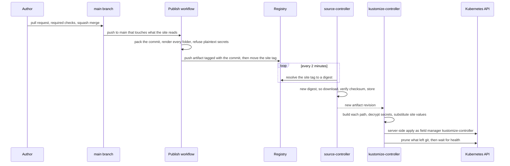
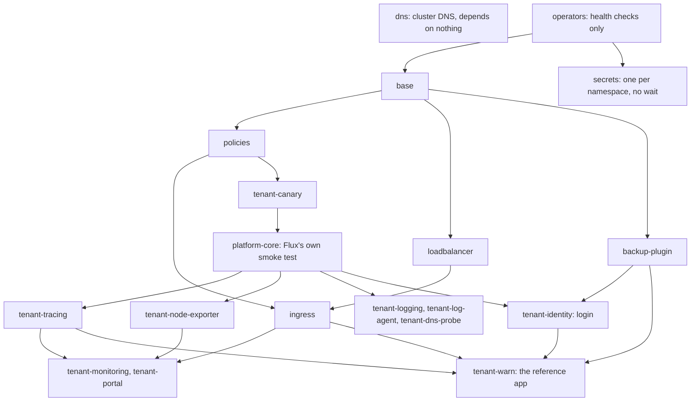

# Academy 3: Flux and GitOps



[Academy](academy.html) · module 3 of 13

## The problem it solves

A cluster that is changed by hand drifts away from any written description of it. On V1.0 this was measured, not guessed. A
retention fix lived only on the live monitoring object for 19 days after a serious incident. Four monitoring objects applied by
hand were lost in a rebuild, which silently switched off a set of storage alerts. Ten alerting values sat committed in git for
days without being applied. And a deploy pipeline that pushed to the cluster raced itself: a second deploy two minutes after the
first rolled an app back to the old image for two days ([History](history.html)).

GitOps answers this with one rule: **git is the only way a change reaches the cluster.** A reconciler inside the cluster reads
what git declares, applies it, removes what left git, and puts back what someone changed by hand. Two things follow from that:

- **The pipeline holds no cluster credential.** CI ends at an artifact in a registry, and nothing outside the cluster can call
  into it. That does not make a stolen CI token harmless: the publish job's token can write the package, and because the
  artifact is unsigned and read through a moving tag, whoever can push it decides what the cluster applies (see "Not proven,
  or open" below).
- **The cluster can be rebuilt from git**, as far as git reaches. The parts git does not reach are the honest limit of the
  rule, and this module lists them.

The price is real: a merged change is applied automatically, with the reconciler's cluster-wide rights. Merge protection and
the integrity of the source become the security boundary. Both are discussed below, with what is still open.

## How it works

There are three moving parts: a publish step in CI, Flux's **source-controller**, and Flux's **kustomize-controller**. Nothing
else of Flux is installed here: no Helm controller, no notification controller, no image automation.



**1. Publish.** A workflow runs on every push to main that changes a folder the site reads. It takes the folders from the
commit with `git archive`, never from a working copy, so only committed content can be published. Before it pushes, it does two
checks that a reconciler reading git directly could not do in advance: every folder the site points at must render with
`kubectl kustomize`, and no file in the site's secrets folder may hold a plaintext value. A tree that fails either is never
published. It then runs `flux push artifact`, which packs the tree as an OCI artifact tagged with the commit and records the
revision as `main@sha1:<commit>`, and moves a tag named after the site to that new artifact. The workflow runs only on main,
on a hosted runner, and holds one credential: its own short-lived token, scoped to write packages. Its first five runs took 20 to
28 seconds each (2026-11-10/11).

**2. Source.** One `OCIRepository` object in the cluster names the artifact and the site tag. Every two minutes the
source-controller asks the registry which digest the tag points at. If the digest is new, it downloads the artifact, checks it
against its digest, stores it inside the cluster, and records the new revision in its status. A registry address plus a digest
names exactly one set of bytes, so the cluster always knows which commit it is running.

**3. Kustomizations.** A Flux `Kustomization` says: take this path from that source, build it with kustomize, apply the result.
Each one carries the knobs that matter:

| Field | What it does | Why it matters |
|---|---|---|
| `interval` | How often the whole path is applied again, even with no new revision | This is what puts a hand edit back |
| `retryInterval` | How soon a failed apply is tried again | A transient failure heals without a person |
| `prune: true` | Deletes objects that this Kustomization applied before and git no longer lists | Removing a file from git removes the object |
| `wait: true` | The Kustomization is Ready only when everything it applied is healthy | Ready means running, not just accepted |
| `healthChecks` | Names objects to wait for even if this path did not create them | Used to watch things installed outside Flux |
| `dependsOn` | Do not start until the named Kustomizations are Ready | Order, without one big all-or-nothing apply |
| `decryption` | Decrypt SOPS-encrypted files with a key held in a Secret | Secrets can live in git as ciphertext |
| `postBuild.substituteFrom` | Replace `${VAR}` in the output with values from a ConfigMap | Site-specific values stay out of git |

**Server-side apply.** kustomize-controller applies with Kubernetes server-side apply, under the field manager name
`kustomize-controller`. The API server records, field by field, which manager set each value. On every interval the controller
compares the whole desired state with the cluster in a server-side dry run, and applies every object that differs, taking
ownership of its fields. Any field it declares is set back to git's value, whoever changed it. That is the whole mechanism behind
"a hand edit is reverted": no separate drift detector, just a full comparison on a timer, and an event that names each object it
changed.

**Pruning.** Each Kustomization keeps an inventory in its status: every object it applied. After an apply, anything in the old
inventory and not in the new one is deleted. An object Flux never applied is never in an inventory, so **Flux cannot see an
object that was made by hand and that git never mentions.** That gap is why a separate drift guard exists (below). An object can
opt out of pruning with the annotation `kustomize.toolkit.fluxcd.io/prune: disabled`; tenant namespaces and databases carry it
here, so a file deleted by mistake cannot delete a database.

**Losing the source.** If the registry cannot be reached, the source keeps its last artifact and the Kustomizations keep
applying it. Running workloads are not touched. In a chaos test on a kind cluster on 2026-11-06, Flux kept correcting drift to the
last state it had, took about 80 seconds to notice the cut, and told nobody, because no alert existed then.

### Why an OCI artifact and not git

Flux can read a git repository directly. This site reads an artifact instead. The reasons, as written in the decision record
for the site's delivery (still proposed, so not yet accepted by the owner):

- **No git credential in the cluster.** The cluster holds only a read-only package token: a classic token whose one scope is
  reading packages, so it can read every package of the account, not just this one. A git source would need a deploy key that
  can read the whole private repository.
- **The cluster never reads a moving branch.** It reads a published artifact, built from one commit, that has already rendered and
  passed the plaintext-secret check.
- **Only what the site needs.** The artifact holds the platform folder, the site folders and each app's deploy folders, not the
  whole repository with its scripts and history.
- **One shape for test and live.** The kind gate in CI publishes the same kind of artifact to a throwaway registry, so it
  rehearses the same two controllers, the same artifact path and pruning. It does not rehearse the live order: the kind site
  is still one Kustomization with no `dependsOn`.

The cost is a second hop that can fail (the registry), and the weakness named in the next section: the tag is moved, and nothing
signs or verifies the artifact.

## Our shape

- **The cluster:** three servers with embedded etcd and three laptop agents, running K3s ([Platform](platform.html)).
- **Flux:** the source-controller and the kustomize-controller, one replica each, installed by a bootstrap script from the owner's
  workstation. Flux does not manage itself.
- **One source:** an `OCIRepository` polling the site tag every two minutes, with a read-only package token.
- **The root Kustomization, `site`:** applied by hand once at bootstrap. It points at the site's `site` folder, which is a list
  of files, one Kustomization per concern. On 2026-11-20 git declares 22 of them below `site`; the live count is on the
  [status page](status.html). Every one has `prune: true`. Leaf entries re-apply every five minutes and retry after one.
- **Secrets:** encrypted in git with SOPS and age, decrypted by kustomize-controller with a key held in a Secret that the
  bootstrap creates. There is one secrets Kustomization per namespace, with `wait: false`. That split came from a real deadlock on
  the first bring-up (2026-11-10): one shared secrets unit waited for a namespace whose pods waited for the secrets.
- **Site values:** values that name this house (the backup store's address, the names apps answer to on the local network) never go
  in git. They live in a ConfigMap made at bootstrap and reach manifests through `postBuild` substitution.

### The order

The site folder lists every entry, but that list sets no order. Each entry names what it needs in `dependsOn`, and Flux starts it
only when those are Ready. An arrow below reads "is needed by".



Three entries show the pattern well:

- **`dns`** depends on nothing, because every other pod, and Flux itself, resolves names through it. It also carries
  `deletionPolicy: Orphan`, and its objects refuse pruning, so deleting the Kustomization by mistake leaves DNS running.
- **`operators`** applies almost nothing. It exists for its `healthChecks`: it is Ready when the admission engine, the certificate
  manager, the Postgres operator and the ingress controller are all available. Everything below waits for it. The operators
  themselves are installed outside Flux, by one of the push paths below.
- **`platform-core`** applies a small set of objects into a canary namespace, with pruning on. It is the reconciler's own smoke
  test on the live site: if this one is Ready, Flux can apply and prune.

Splitting the site into one Kustomization per concern matters under failure. In the first design one Kustomization held every
tenant, so one crash-looping app held the whole site not Ready, and suspending it froze everything. Now a failing tenant stops
only what depends on it.

### What Flux does not own: the push paths

Anything that reaches the cluster by any route other than Flux pulling the artifact is a push path. Each is a place where git is
not the only way in. The list, read from the bootstrap runbook and the delivery decision record on 2026-11-20:

| Push path | What it writes | How often | Status |
|---|---|---|---|
| The host layer (playbooks run from the workstation) | The machines, K3s and its config, and K3s's own manifests folder | Every host change | **open:** a pull timer on each host is decided, not built |
| The bootstrap script | Flux itself; four Helm releases (admission engine, certificate manager, Postgres operator, ingress controller); and, before Flux exists, the cluster DNS folder (applied server-side under Flux's own field manager name, so Flux takes it over cleanly) and the ingress namespace | Bring-up, and every operator or Flux upgrade | **open:** a chart bump merged in git does not reach the cluster until someone re-runs the script |
| Hand-made objects at bootstrap | The age key Secret, the registry pull Secret, the site-values ConfigMap, the load-balancer range, and the `site` source and root Kustomization | Bring-up; a change to them in git does nothing until re-applied | **built**; recorded in a decision record that is still proposed, not accepted; nothing compares them with git |
| K3s's manifests folder | The load balancer's cloud provider, also applied by Flux; also the bundled metrics server and local storage provisioner, kept on purpose | Every K3s server start | **open:** two writers by design (below) |
| Drills by hand | Scratch databases and temporary network policies during a restore drill | Per drill, deleted after | **built**, by procedure |

The publish workflow is not on this list: it pushes to the registry, never to the cluster.

### The second-writer problem

Two controllers that each believe they own the same field undo each other. The result is either a value that flaps, or a value
that one side silently resets at a moment nobody watches. Server-side apply makes this visible, because the managed fields name
every writer, but it does not stop it. The cases met here:

- **The K3s CoreDNS add-on (removed 2026-11-20).** K3s ships CoreDNS as an add-on and re-applies it from its own manifests on
  every server start, resetting it to one replica. The first design held it at two with an autoscaler and a disruption budget
  in git, so git and K3s both wrote it. A power-off drill on 2026-11-19 showed that two replicas were not enough either: for the
  minute before a dark node was marked NotReady, its DNS pod stayed in the Service, and lookups on the other nodes stalled for 51
  seconds. The replacement, a CoreDNS on every node from git, fixes both problems. Taking the Service away
  from K3s took five steps, each judged by a DNS probe on every node: run ours beside the add-on; let Flux take over the Service by
  server-side apply; remove K3s's ownership label from the Service, because K3s deletes an add-on's objects by that label; disable
  the add-on in K3s's config and restart the servers one at a time, the one holding K3s's own lease last; restart once more to see it
  stay gone. It stayed gone across four server restarts. It has not yet been through a K3s upgrade.
- **The load balancer's cloud provider (open).** The host layer drops it into K3s's manifests folder, because the cluster needs it
  before Flux exists. Flux then applies a hardened copy. On 2026-11-11 the live Deployment had two field managers, `k3s` and
  `kustomize-controller`. On the first bring-up the two copies carried conflicting rollout strategies; the fix made both valid,
  rather than removing a writer. One owner is still to be chosen.
- **An autoscaler and `replicas` (built).** If git sets `replicas` and an autoscaler owns the count, every re-apply resets the
  count. A check in the required CI job fails the app template, or the reference app's deploy folder, if a workload sets both.
  Platform services and site folders are not checked by it.
- **A hand restart (V1.0 lesson).** `kubectl rollout restart` writes an annotation under kubectl's name. On V1.0 Flux removed it on
  the next apply and the pods rolled again. Restart through git, or through a writer with its own field manager.

### The drift guard

Flux puts back what git declares. It cannot see an object git never mentions, and it does not see the operators or itself. The
drift guard is a separate, read-only script that compares the live cluster with git. It reports six kinds of finding:

| Finding | Meaning |
|---|---|
| `live-only` | A live object with no owner that no path in git names: made by hand, or left behind |
| `flux-orphan` | Flux made it, git no longer names it: pruning is off or failed |
| `helm-drift` | A Helm release runs another chart version than the pin in git |
| `unrendered` | A path a Kustomization names does not render offline: a hole in the guard |
| `unreadable` | A kind the guard's identity could not list: also a hole in the guard |
| `stale-allow` | An allowlist entry past its end date, or one that matches nothing |

Two design choices keep it honest. It never prints "no drift" after a partial read: exit 0 means no finding, 1 means findings, 2
means it could not read the site. And every allowlist entry needs a reason and an end date; an expired entry lets nothing through.
What it trusts is stated: objects with an owner reference or a managed-by label are skipped, so a hand-made object that carries
such a label is not seen. It does not read Secrets.

## How we operate it

**Make a change.** Open a pull request, let the required checks pass, merge. The publish step runs, the source sees the new digest
on its next poll, and every Kustomization whose path changed applies. On 2026-11-20 one DNS step was applied 34 seconds after its
merge. To skip the wait: `flux reconcile kustomization NAME --with-source`.

**Read the state.**

```sh
flux get sources oci -A           # the tag and digest the cluster holds
flux events --for OCIRepository/NAME   # the NewArtifact event names the origin commit
flux get kustomizations -A        # Ready or not, and the revision each one applied
flux events --for Kustomization/NAME
flux logs --kind Kustomization --name NAME
```

**Hand a component over to Flux.** Write the component's folder, then one file in the site folder with its Kustomization (path,
`prune`, `wait`, `dependsOn`), then one line in the site folder's list. The line is the handover. If the objects already exist
live, look first at who owns their fields: `kubectl get KIND NAME -o yaml --show-managed-fields`. On V1.0 a server-side dry run
predicted no change on the first handover, and a pod rolled anyway, because Flux removed fields that kubectl managers had written
and git did not declare. V1.0 had a read-only preflight script that listed those fields; its first run found exactly the case that had rolled the pod. Here the same
preflight is a written rule and **planned**; today the managed-fields read is done by hand.

**Suspend and resume.** `flux suspend kustomization NAME` stops applying and pruning for that entry; a hand change then stays. It
is used in the runbooks, for example to stop a monitoring component so its alert can be made to fire. `flux resume kustomization NAME`
applies git again at once. A suspension is the most likely thing to be forgotten, so the alert below covers it.

**When a Kustomization is not Ready.** The alert `FluxKustomizationNotReady` fires after 15 minutes of not Ready or suspended, and
`FluxSourceNotReady` after 15 minutes of a source that cannot pull. `FluxControllerNotScraped` fires after 10 minutes when a
controller disappears, since then the other two cannot be trusted. Then, in order:

1. `flux get kustomizations -A`: which one, and its message.
2. If the message is "dependency ... is not ready", go up the chain: the first entry that is not Ready is the real one.
3. A health check timeout means something applied but did not become ready: read the pods and their events. In the power-off
   drills of 2026-11-19, entries whose health checks waited for pods on the dark node went not Ready this way (the alert was
   pending, not yet fired); in one drill every entry was Ready again about two minutes after power-on.
4. An apply error means the API server or admission refused an object. An image the admission engine refuses shows up here, or
   as a health check timeout when only the pods are refused.
5. A suspended one is on purpose or forgotten. Find out which before resuming.

**Roll a bad change back.** Revert the commit in git and merge the revert. It travels the same path as any change. While the bad
revision is applied, what already ran keeps running: a Deployment whose new pods never become ready keeps its old ones, and the
Kustomization stays not Ready and retries every minute. On V1.0 a bad manifest held the rollout and recovered when git was
reverted. Two limits: a revert does not undo a database migration that already ran, and the emergency path (pointing the source
at the previous commit's artifact by hand) is itself a change outside git and has not been rehearsed.

**Upgrade Flux and the operators.** Today both are a script change and a re-run from the workstation. The Flux version in the
cluster is whatever the command line there is; the drift guard prints it, nothing pins it.

**Limits to keep in mind.** A merged change is live within minutes, with the reconciler's rights, and there is no staging site.
The kind gate in CI rehearses Flux on the kind site's folders, not the live site's. For the live site's folders the checks before
the cluster sees them are static: the repository's own checks pass, every folder renders, and no secret is plaintext.

## Proven and not proven

**Proven** (seen working once, on that date; each item says where: live site, kind in CI, or a throwaway kind cluster):

- **2026-11-10, live:** the site applied from git onto six blank machines, and the reference app became Ready. The first run found
  three faults (the secrets deadlock, the two-writer strategy conflict, a quota too small), each fixed in git. It took about four
  and a half hours with a person at the keyboard, by playbook and then the bootstrap script with its hand-made objects; one
  command from blank is not proven.
- **2026-11-10, live:** during the first restore drill a tenant's quota was patched by hand to make room. Flux reverted every hand
  patch within minutes, so only a change in git held. This was not a planned drift test: it was a few fields on one object, seen
  by accident. The planned test runs on kind (below), and no deliberate revert test has run on the live site.
- **In CI, on kind, for every change to the platform or site folders:** the kind gate hand-patches a ConfigMap and sees Flux
  revert it with an event, then adds an object and removes it again and sees it pruned. The gate fails if pruning is off or the
  Kustomization is suspended.
- **2026-11-11, live:** the drift guard read the live site. Before its allowlist and trust rules it reported 27 findings, all the
  platform's own; after them, none.
- **2026-11-11, on kind:** a planted ConfigMap and a Helm release hand-moved to an older chart were both found, the drift alert
  was raised in a real Alertmanager, and it resolved after the plants were removed.
- **2026-11-11, on a throwaway kind cluster:** a Kustomization that was not Ready, and one that was suspended, raised
  `FluxKustomizationNotReady` in Alertmanager.
- **2026-11-20, live:** the K3s DNS add-on was removed as a second writer and stayed gone across four server restarts; one step was
  applied 34 seconds after its merge.

**Failures, kept on the record:**

- **2026-11-06, on kind:** with its registry cut off, Flux kept enforcing the last state and nobody was told. The alerts above
  exist because of that run.
- **2026-11-20:** one change-over step was merged in the same command that read the previous step's baseline, so two failed
  lookups were seen only after the next step was already live. Flux applied it 34 seconds later. The rule since: read the referee,
  then merge.

**Not proven, or open:**

- **The artifact is not signed and is read through a moving tag.** Whoever can move that tag decides what the cluster applies, and
  Flux verifies nothing. The preferred fix is to sign the artifact in CI and have Flux verify it (**open**).
- **Merge protection is thin.** A pull request and the required checks are needed, but 0 approvals are required, and every merge
  is under one human login (**open**). A bad merge is live within minutes with the reconciler's rights.
- **Each Flux controller is one replica.** While its node is down, no change, restore or containment goes through git; running
  apps keep running. The single-point register lists it, with the choice between a second replica and accepting one still open
  (**open**).
- **Flux, the operators and the bootstrap objects are outside Flux** (the push paths above). "What would git alone bring back?"
  fails for them (**open**).
- **The drift guard runs by hand.** A daily run needs an identity that can list every kind but not read Secrets, and a place to run
  it; both are a decision not yet made (**planned**). Its alert has not reached a person.
- **No prune test on the live site is on record**, and no gate removes a tenant to prove its namespace survives (**open**).
- **Rollback by revert has not been rehearsed on the live site** (**open**).
- **One alert covers both a suspended and a broken entry**; its labels say which, but no test has yet had a suspended entry that
  was Ready before. No Flux alert has been seen to fire on the live site: it was pending, not firing, in the power-off drills of
  2026-11-19 (**open**).
- **The DNS add-on removal has not been through a K3s upgrade** (**open**).

## Try it yourself

About 20 minutes on a laptop with Docker, [kind](https://kind.sigs.k8s.io/), kubectl and the
[flux command line](https://fluxcd.io/flux/installation/). You build the same loop as above: an artifact in a registry, a source,
a Kustomization with pruning, and then you break it.

**1. A cluster, a registry beside it, and the two controllers.**

```sh
kind create cluster --name gitops-lab
docker run -d --name oci-store --network kind -p 5001:5000 registry:2
flux install --components=source-controller,kustomize-controller
```

The registry answers `localhost:5001` from your laptop and `oci-store:5000` from inside the cluster.

**2. A tiny "repository" and its first publish.**

```sh
mkdir -p lab/deploy && cd lab && git init -q
cat > deploy/greeting.yaml <<'EOF'
apiVersion: v1
kind: ConfigMap
metadata:
  name: greeting
  namespace: default
data:
  message: hello from git
EOF
cat > deploy/keep.yaml <<'EOF'
apiVersion: v1
kind: ConfigMap
metadata:
  name: keep
  namespace: default
data:
  note: so the folder is never empty
EOF
git add . && git commit -qm "first"
publish() (
  set -e
  sha=$(git rev-parse HEAD)
  tmp=$(mktemp -d)
  git archive HEAD deploy | tar -x -C "$tmp"
  flux push artifact "oci://localhost:5001/lab:$sha" --path="$tmp/deploy" \
    --source=local --revision="main@sha1:$sha"
  flux tag artifact "oci://localhost:5001/lab:$sha" --tag live
)
publish
```

`publish` packs the commit with `git archive`, not the working copy, and stops at the first error, the same rule as the real
workflow. An uncommitted edit is not published.

**3. The source and the Kustomization.**

```sh
flux create source oci lab --url=oci://oci-store:5000/lab --tag=live --insecure --interval=1m
flux create kustomization lab --source=OCIRepository/lab --path=./ --prune=true --wait=true --interval=1m
flux get kustomizations
kubectl get configmap greeting -o jsonpath='{.data.message}{"\n"}'
```

**4. A hand edit, and who owns which field.**

```sh
kubectl patch configmap greeting --type merge -p '{"data":{"message":"changed by hand"}}'
kubectl get configmap greeting -o yaml --show-managed-fields | grep -A2 manager:
flux reconcile kustomization lab
kubectl get configmap greeting -o jsonpath='{.data.message}{"\n"}'
flux events --for Kustomization/lab
```

The message is back to git's value, and the event names the object it configured. Before the reconcile, the managed fields
showed two managers; look again after it.

**5. Suspend, and the edit stays.** Run `flux suspend kustomization lab`, patch again, and wait two minutes: the edit stays. Then
`flux resume kustomization lab`, and it is gone.

**6. Prune.** Run `git rm deploy/greeting.yaml`, commit, run `publish`, then `flux reconcile kustomization lab --with-source`.
The ConfigMap is deleted; `keep` stays because git still lists it. Now re-create `greeting.yaml` with the annotation
`kustomize.toolkit.fluxcd.io/prune: disabled`, commit, publish, then delete it again, commit and publish: this time it stays.

**7. A bad change and its revert.** Commit a Deployment whose image does not exist, publish, and watch `flux get kustomizations`
go not Ready on the health check. Then `git revert HEAD`, publish again, and watch it recover.

**8. Clean up.** `kind delete cluster --name gitops-lab` and `docker rm -f oci-store`.

Question to take away: in step 4, what would a second controller writing the same field have done, and how would you have noticed?

## Further reading

- Flux [OCIRepository](https://fluxcd.io/flux/components/source/ocirepositories/) and
  [Kustomization](https://fluxcd.io/flux/components/kustomize/kustomizations/) references, including `dependsOn`, health checks,
  pruning and decryption.
- Flux's guide to [OCI artifacts](https://fluxcd.io/flux/cheatsheets/oci-artifacts/), including how to sign and verify them with
  cosign, which is the open item above.
- Flux's guide to [SOPS](https://fluxcd.io/flux/guides/mozilla-sops/) and the [SOPS project](https://getsops.io/).
- Kubernetes [server-side apply](https://kubernetes.io/docs/reference/using-api/server-side-apply/): field managers and conflicts.
- [OpenGitOps principles](https://opengitops.dev/).
- On this site: [the delivery chain](platform.html), [how we work](how-we-work.html) (especially
  [the two axes](how-we-work.html#two-axes-what-you-write-and-who-applies-it)), [DevSecOps](devsecops.html) for signing and
  admission, [reliability](reliability.html) for the drills, and the [status page](status.html) for the live count. The previous
  module is [CI at home](academy-ci.html); the [big picture](academy-big-picture.html) shows where this module sits.

<script type="module">
  import mermaid from 'https://cdn.jsdelivr.net/npm/mermaid@11/dist/mermaid.esm.min.mjs';
  mermaid.initialize({ startOnLoad: false, theme: 'neutral' });
  document.querySelectorAll('pre > code.language-mermaid').forEach((el) => {
    const div = document.createElement('div');
    div.className = 'mermaid';
    div.textContent = el.textContent;
    el.parentElement.replaceWith(div);
  });
  mermaid.run();
</script>
