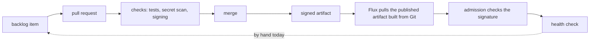


# AI in development, held to the same bar as AI in production



-orange?logo=github&logoColor=white)
-orange)

[The run-time half of this story](aiops.md) — the **run-time edge** — is a small local
model with a narrow write path to the live cluster, whose posts a cloud model grades once a day. This is the other half, the
**development edge**: the cloud model used to *build* the estate in the first place — which
repository, which line, which architecture call. It gets exactly one exemption from the
rules below: none.

---

## Where it sits in the loop

Not a chat window on a second monitor. The model works from the editor and from a terminal
agent, against the same backlog and repository a human contributor would use. The loop it
sits in:

The last arrow is dashed because it is not wired. Nothing turns a recurring anomaly into a
backlog item automatically; the author notices it and writes the item. No Jira link is
recorded in this loop on the new platform (2026-11-11): delivery is a pull request, the checks,
a signed artifact, and Flux applying the published artifact built from Git. Monitoring is not live on the new
cluster (no monitoring namespace on 2026-11-11; its rollout is merged but not finished), so there is no "live signal" step to draw. *V1.0 (retired 2026-11-10):*
the loop also had a Jira item, a code-quality server and auto-deploy for three apps.

**The rulebook the model reads first.** The platform repository (a new private repository
since 2026-11-05) carries an `AGENTS.md` of working agreements that every AI session reads
before it touches anything. One of them is: read the whole output. A filter that matches
nothing reads as a confident zero, and that has produced a false all-clear twice, so use a
command's own filters, or save the output and read it. (*V1.0:* this was called
Rule Zero and banned `head`, `tail` and `grep` outright.) Another is that a green status line
is a claim, not evidence. That is
checkable, which is more than can be said for a sentence about "governed connections".

---

## No exemption, and that is the whole design

A change proposed by the cloud model walks through [the same gate table](devsecops.md) as any
other: static analysis, secret scan, tests, signing. Nothing merges on the model's say-so.
It cannot be a shortcut past review, because it has no review powers to shortcut with.

"Same gates" is not "all green". On the new platform, first-party images are signed in CI and
signature enforcement is configured and Ready on the live cluster (checked 2026-11-11), and the running Warn image passes it. A refusal of an unsigned image was shown on a local test cluster on 2026-11-07, not yet on the home site. How many running images verify:
not measured yet. [The status page](status.md) shows what else is measurable. The rule is that
nothing is exempt, not that nothing is red.

### Who reviews, honestly

**New platform repository, measured 2026-11-11.**

- **101 of 101 commits on the main branch carry the AI co-author trailer**, counted at the time of writing, 2026-11-11. The repository is six days old.
- **100 of those 101 commits carry a pull request number.** The one
  exception is the first commit, the charter. Whether branch protection is on was not checked for this page.
- **Every commit is under one human login**, so git alone does not show whether the owner
  approved an important change. A bot or an agent committing under that login looks the same as the person.
- **The merge-approval scheme is a decision record that is still Proposed** (owner approves important
  changes, a separate reviewer agent handles the rest). The reviewer identity does not exist, and
  required approvals are 0 per the decision record. Until that exists, the owner reads the important pull requests by hand;
  that is a practice, not something the repository enforces.
- **The agent working rules are stricter than that record.** An agent merges only when the owner has
  asked, never with the admin override, and never changes branch protection, rulesets, environments or
  secrets. Review by an agent would be a second identity, not independent judgement.
- **Dependency updates:** Renovate is configured; I have not yet seen it act.

*V1.0 repository (retired 2026-11-10), kept as history.* This was a one-person repository, so the gate was CI, not a second human. One person read and
pushed every change and was accountable for it. **That changed on 2026-10-18, in form but not in
substance.** Until then almost nothing went through a pull request (3 merge commits in the history,
and an outside review on 2026-10-14 counted 303 of 323 recent commits straight to the main
branch). Since then the practice is pull requests: 112 of the 133 commits made between
2026-10-18 and 2026-10-27 carry a pull request number (27 of the 133 are bots). They are
merged by the person who wrote them, and the code owner file naming that person as required
reviewer cannot be enforced: on this private repository, on the plan in use, the branch protection
and ruleset APIs both answer 403. A pull request without a second pair of eyes still gives a
named point for CI to gate on, a diff that is read before it merges, and a number to cite.

> **Retraction, 2026-10-09 (about the previous repository).** This page used to say that every non-draft pull request gets the
> model requested as a reviewer automatically, and that both the human and the model were
> required. Neither was true. A workflow does ask for an AI reviewer on each non-draft pull
> request. GitHub rejects the request with HTTP 422, because the reviewer is not something it
> will accept for this repository. The step ends in `|| echo`, so the job still reports
> success. Of the 27 runs it has had, 11 failed outright and 15 of the 16 green ones show the
> same 422 in their log. Of the 41 pull requests ever opened, none has a review or a review
> request. A review that cannot be requested cannot be required, and a non-fatal step cannot
> gate a merge. I found it by reading the logs, not by trusting the green tick, which is the
> thesis of this site pointed at itself. The fix is to make the failure fatal, or to remove
> the claim; until then, an AI review is not part of the process.

So the real review process on the previous repository was one accountable human, the CI gates,
and the model in the session where it wrote the change, which is not independent of the change.
On the new repository (2026-11-11) it is the same in substance: CI gates, one human login, and no
independent reviewer yet.

> *Pure vibe coding remains an aspirational dream for professional work for me, for now.
> Supervised collaboration, though, is here today.*
> — DHH, [Promoting AI agents](https://world.hey.com/dhh/promoting-ai-agents-3ee04945), 7 January 2026

Weeks after writing that, DHH's team tried the opposite. In his account, from around
February, designers were to ship through agents with no programmer in the loop:

> *We let them vibe. And we ended up with a lot of PRs that individually perhaps could have
> been justified for a hot moment, but taken all together, destroyed the architecture of the
> system. And we actually had to clean up manually, mop it up by hand.*
> — DHH, [Lex Fridman Podcast #501](https://lexfridman.com/dhh-2-transcript/) (transcript, published August 2026)

He adds, in the same answer: "that was February, by the way. Things are quite different now."
So the claim is narrower than "agents fail". Unsupervised agents fail in ways that no single
pull request shows, and that is why the rule here is supervision, not a verdict on the tools.

---

## What "does it actually work" looks like when you ask it honestly

**What it clearly does well, on the evidence.** As of 2026-11-11 the new platform repository
holds 8 architecture decision records (3 accepted, 5 proposed) in 101 commits over 6 days,
all by one login, all with a `Co-Authored-By` Claude trailer (counted 2026-11-11 with `git log`).
That is the checkable credit, and it shows volume, not quality.

*V1.0 repository, counted 2026-10-27 (retired 2026-11-10):* 41 decision records in 1,943
commits over 309 days, 1,897 of them by one person; the other 46 were bots. One of its four
post-mortems named its AI assistant in the byline (a draft, not the post-mortem published on [the incident
page](incident.html)). 123 of its commits carried the trailer.

**What it has not been made to prove.** As of 2026-11-11 there is no acceptance-rate metric,
no measured defect-escape delta, no before/after quality comparison. The trailers do not fill
the gap: 101 of 101 says the AI took part in every commit, not whether the result is better.
On the old repository 123 of 1,943 undercounted early use. The cheapest measurement to try
first is the share of commits co-authored by AI against the revert and fix-up rate. Until then the honest claim is *"this
clearly helps"*, not *"this improves output by a stated percentage."*

**The most useful failures, because they prove the discipline is needed.** Two, and neither
was the model's alone.

- The review request above: the flagship control was inert, configured and plausible, and
  reported success.
- *V1.0, before 2026-11-10:* during one self-review pass the model reported stale and partly wrong facts about the
  platform it was describing: that a piece of autoscaling configuration was absent when it was
  live, and that no restore drill existed when one already did. Neither survived a query
  against the live system.

Neither is an indictment of the tool. It is the failure mode every engineer using one should
expect and check for.

> **AI accelerates the work. Verification is still the job.** The same rule this whole site
> applies to chaos controllers and reboot daemons applies to the model that helps write about
> them: read the value back off the live system before you believe the report, including the
> report the model just gave you. The page you are reading was itself corrected on
> 2026-10-09, and again on 2026-11-11, by a fact audit against the live system and the repositories.

---

## Where the line still sits

- **Nothing it proposes reaches production without a human accountable for it.** The human is
  the owner who asks for the merge, not a review click; the repository itself cannot yet show
  who approved what (2026-11-11).
- **It has no path to the cluster that skips the gates.** [The pipeline](platform.md) does not
  know or care who authored a diff.
- **It is a different model, in a different place, for a different reason** than
  [the one that watches the cluster](aiops.md). Development-time judgement and a live write
  path to the cluster are not the same risk, and they are not given to the same system. Using both,
  a frontier cloud model and a small local one, is also on purpose: the aim is to learn AI at both ends.

---

## Read next

- **[The operations agent](aiops.md)** — the run-time half: a local model with a
  narrow, audited write path to the cluster.
- **[DevSecOps, end to end](devsecops.md)** — the gate table every change walks through,
  regardless of who or what proposed it.
- **[Testing, quality gates, and grading our own maturity](quality.md)** — the same
  no-exemption principle applied to code quality: fast lane, slow lane, and an honest score.

---

Written for publication. No hostnames, addresses, credential locations or internal tool
identifiers appear here, and a guard fails the build if they ever do.

