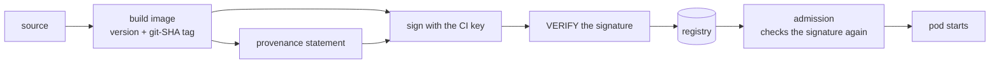




Security controls are easy to install and hard to keep honest. This page walks the whole
chain, commit to running pod, and at each stage says what the control *actually proves*
rather than what it is marketed to prove.

**What changed, and how to read this page.** On 2026-11-10 the platform this page used to
describe was torn down, and a new cluster was brought up that night and on 2026-11-11 (three
control-plane servers and three laptop agents). Sections 1 to 5 and 7 describe the new
platform. Every claim there carries a date and one of four words: **proven** (seen working on a live run, with a date), **built** (in place, not yet seen working),
**planned**, or **open** (defined once on [how we work](how-we-work.html)). The cluster is about a day old, so nothing here says anything about
how it behaves over weeks. Figures that are not measured yet say so; none is carried over from
the old platform. The old platform's gates, scanning, exposure and host material is in §8, in
full, dated, and labelled as history. Section 6, the measurement traps, is kept in place
because its lessons did not depend on the platform.

> **Not running: monitoring.** The monitoring tenant was merged into the main
> branch on 2026-11-11 once its two secret files were added, and Flux is applying it. It is not
> Ready: its first live run failed on a missing-namespace defect in the node exporter manifests,
> and a one-line fix is in review. It has never run, so there are no alert rules or dashboards to count. Anything that
> would need them says "not measured yet".

---

## 1. The gates before a commit becomes an image

Status of this section: the gates exist and ran on 2026-11-10 and 2026-11-11. What each one
proves is stated per row; "proven" means seen to fail on purpose.

| Gate | Where it runs | Catches | Status |
|---|---|---|---|
| **Pre-commit** (62 hook ids, 2026-11-11) | on the author's machine | a secret in the working tree, and a **secret scan over the whole history**, plus the check scripts below | built; each hook's self-test is proven below |
| **Check scripts** (30 scripts in the scripts folder define a `--self-test`, 2026-11-11; 20 of them are named `check-*`, the rest are build, lint and gate helpers) | pre-commit and the pull-request workflow | each one a rule of the repository (an objective is cited, a pin has a marker, a manifest has the right shape) | proven: each self-test plants the failure and must see it caught |
| **The kind gate** | pull request | the warn gate on a throwaway local cluster: the site applied there, then the checks against it | built, passed once: green on 2026-11-10 after two red attempts, each a flake of the gate itself and fixed since; not shown to pass every time |
| **The aggregate ci-gate** | pull request | one check that is green only when the others are | built; deliberately **not** a required check yet, fix open (see below) |
| **The objectives line** | pull request, by a workflow that runs from the base commit | a pull request that does not say which objectives it touches | proven: the workflow reads the base commit, so a pull request cannot change the script that judges it |
| **Contract fuzzing against the OpenAPI** | against the reference app | responses that break the published schema | proven: when the fuzz was added (around 2026-11-07 and 11-08) it found eight faults, since fixed. A ninth, a repeated `radius` parameter accepted, was still open on 2026-11-11 |

**A test counts only once it has been seen to fail on purpose.** That is the rule behind the
self-tests. The controller that provisions the home CI runners goes further: its self-test is
gated by 221 mutants, each a small deliberate breakage of the controller, and the gate passes
only if every mutant makes the self-test fail (as stated in the runner runbook of 2026-11-09; not recounted since).

**The aggregate gate is deliberately not a required check yet; the fix is open.** It exists so that one place says
"everything that ran, passed". Which checks block a merge is set on the checks themselves, so the
aggregate adds a summary, not a second lock. That is deliberate, with the fix open, not a claim that it protects
the main branch by itself.

**What is not in the new set.** The static code analysis of the old pipeline, the web-app
baseline scan, the exposure contract and the rate-limit contract are not part of it. The last
two asserted properties of a public edge, and the new platform has no public entrance on
2026-11-11 (one LAN-only ingress for the reference app), so there is nothing for them to assert (§8.4). Image vulnerability scanning and
SBOM generation in pull requests are **planned**, not built.

None of these gates check who, or what, authored the commit. **A change proposed by
[the cloud model used as a development peer](index.md) walks through the identical gates**,
and a human reviewer is still accountable for what it produced. AI-assisted is not a bypass
lane.

---

## 2. Build, sign, and the step most people skip



Two decisions carry most of the weight.

**Provenance: built, not verified at admission.** CI attaches a provenance statement, but admission does not check it (record of 2026-11-07), so nothing on the cluster relies on it yet.

**The signature is verified, not merely produced.** Signing without a verification step is
ceremony. The pipeline verifies right after signing, and the cluster verifies again when the
pod is created (§3). The verify step is the control; the signing step is its input.

**The signing key is reachable only from the main branch.** First-party images are signed with a
CI key stored as a secret of a GitHub environment that only the main branch may use, so a
pull request, including one from a stranger, cannot reach a signing key. The key was rotated on
2026-11-08. The key's custody is an open item. Status:
**built; the rotation is recorded, and the main-only restriction is configuration I have read
rather than attacked.** "How many running first-party images verify" is **not measured yet**.

**Tags carry the version and the commit, never a floating `latest`.** A floating tag lets a
rollout pull a cached older layer and report success, so "what is running" stops being
answerable at the moment you need the answer. Upstream (vendor) images are pinned by digest
from a closed list instead (§3).

---

## 3. Admission: the cluster refuses what the pipeline did not build

Status: **proven** on 2026-11-11 (live and Ready when read). Two policies, both
in Deny mode, both with failure policy Fail, so if the engine cannot decide, the pod is
refused rather than let through.

| Policy | Refuses | Status |
|---|---|---|
| **Image signature** | a pod whose first-party image is not signed by the CI key | proven on a throwaway local cluster on 2026-11-07 for three cases: signed passes, signed by another key is refused, unsigned is refused |
| **Closed vendor list** | a vendor image that is not on the list, or is listed but not pinned by digest | one off-list image was refused on the real site on 2026-11-10; that is a line in the history of the day, not a gate record |

How a namespace comes under the rules: **namespaces opt in by label**, which the tenant
template sets. The admission engine's own namespace and the operators' namespaces never opt in,
because a policy that refuses its own engine's pods can lock the cluster out of repairing
itself.

What I have not yet recorded: the refusal of a listed image that is *not* pinned, and the
refusal of an image signed by *another key*, on the real site. Both are written as procedures and
neither has been run and written down (**open**). The local-cluster proof is not the same
claim as a proof on the site that matters.

---

## 4. Network policy, Pod Security and quota

**Network policy** (read 2026-11-11): 27 policies. Each of the four tenant namespaces has a
default-deny policy plus the allows it needs. The engine is the network controller built into
K3s.

> **The default-deny probe failed on 2026-11-10.** The probe starts a pod and tries to reach
> what should be denied. For a window of one to three seconds at pod start the traffic got
> through, before the policy took effect. Status: **FAIL, open.** Two further things are not
> tested at all: ingress from outside the namespace, and limits on DNS egress.

**Pod Security** (read 2026-11-11): a restricted level is set on 6 of the 13 namespaces. Four tenant
namespaces *enforce* restricted. One namespace enforces baseline and audits restricted. The
reconciler's namespace only warns. The rest, which hold the engines and operators, carry no
label. Status: **proven** (2026-11-11) as a count, **open** as a boundary: I counted labels; I did not try to
start a privileged pod in each.

**Quota** (read 2026-11-11): 5 quota objects. A quota refused the database replicas, first on CPU limits and then on memory requests, because the namespace's totals were set for the application alone. The first
fix was a hand patch, and it did not hold: Flux reverted every hand patch within minutes, as it should. Only a change
in git held. That is the intended behaviour, learned the slow way.

---

## 5. Secrets and the supply chain, honestly

**Secrets in git** (status: **built and in use**, 2026-11-11). Secrets are encrypted with SOPS
and age before they are committed. They are applied in per-namespace units, because a single
unit deadlocked on first apply: the decryption key had to arrive before anything that needed
it. Values enter by files, never typed on a command line and never passed as an argument, so
they stay out of shell history and process lists.

- **Recovery of the encrypted values from the recovery key has not been tested. Open.** An off-machine copy
  and a tested restore are planned.
- **Rotation of the old values is open.** The values from the previous platform remain in the
  previous repository's history until rotated.
- **Encryption at rest** is configured in the API server's configuration. It has not been
  read back from the live API server, so the status is **built**.

**Supply chain, what the digest does and does not prove.** Vendor images are admitted by digest
from a closed list. The digest was read from the registry on a pull request and reviewed. So the
cluster trusts *the digest as pinned on a reviewed pull request*. It does **not** prove the bytes
came untampered from the vendor, because no vendor signature is checked. That is an **open gap**.
The Flux artifact that carries the manifests to the cluster is also **unsigned. Open.**

**Dependency updates.** Renovate is configured: a cooldown of 3 days after release, and patch updates merge
themselves once every check is green; majors wait 14 days; the security tools and the
admission and signing engines also wait 14 days and carry `needs-owner`, so they never merge
themselves; risky areas (workflows, check scripts, hooks, the
contract) carry a `needs-owner` label and never merge themselves; Kubernetes moves one minor
at a time; at most 3 pull requests are open. Status: **configured, not yet seen acting.** The
app install it waits for is pending, so every pin is frozen on 2026-11-11.

**Where CI runs** (2026-11-11). Jobs that hold a key run on GitHub-hosted runners again, inside a
$20 budget. Heavy jobs that need no secret run on a virtual machine per job on a machine at
home.

---

## 6. Measurement traps found by checking

Each of these produced *confident, wrong* numbers. They were found on the previous platform,
on a vulnerability tracker that **no longer runs** (it went with the old cluster on
2026-11-10). The lessons did not depend on the tracker, so they stay. The dated figures are
receipts from the time; I cannot re-measure them.

**Most of every SBOM was unmatchable filler.** The generator's file cataloger emitted a
component per file: bare paths, no package identifier. A vulnerability tracker matches on
package identifiers, so those rows could never produce a finding. In the worst case, one
application, **7,110 components were 6,847 noise**; turning the cataloger off left about 260,
with the matchable set byte-identical. The repo's own comment gives the general range as
85 to 96 percent of an SBOM. On a minimal base image: 92 components to 15, the same 14
packages. (I once wrote 264 for the remainder; 7,110 minus 6,847 is 263.)

**A rejected upload still created the project.** The generator's default output format had
moved to a specification version the tracker rejects. The upload returned an error, *and the
project was created anyway, with its tags applied*. "Does the project exist?" would have said
yes forever while nothing was ingested. The format is now pinned, with a comment saying why.

**The inventory API caps result rows regardless of the requested page size.** "No test-scope
dependencies are present" was concluded from the first 100 of 7,110 components. It happened
to survive the full set, but the evidence had not earned it. The honest total is in a
response header.

**A 403 with an empty body is indistinguishable from zero violations.** The credential that
uploads SBOMs had never been granted permission to read policy violations back, so every
"did this fail the policy?" query returned an empty, unauthorized response that looked
exactly like a clean pass. The fix was a permission grant, not a policy change; until then a
policy that fired correctly was invisible to the one system meant to act on it.

**Licence data was generated correctly, then deleted immediately before upload.** One filter
clause stripped every licence from the SBOM on its way to the tracker. It arrived with the
nightly scan on 2026-05-24 and was removed on 2026-08-13, 81 days. Its
justification was written down and *true when written*: an older tracker rejected the
licence formats, and licences were not needed for vulnerability matching. Both halves
expired when the tracker was upgraded and a copyleft policy began to need exactly that field.

Found by testing the assumption rather than reading the comment: upload the unfiltered
document and see. It returned success, ingested **243 licences** (at the time, 2026-08-13),
and the copyleft policy fired for the first time. Four applications went from zero licences
to a full set. Two theories were tested and **disproved**
on the way, which is the part worth keeping: a merge step was suspected of stripping the
licences (it keeps both copies), and the tracker of preferring the licence-free duplicate (it
keeps the licence). Guessing would have produced a plausible fix for the wrong cause.

> **Defensive code written against an external tool's behaviour has an expiry date, and
> nothing tells you when it passes.** A comment explaining why something is disabled is a
> claim about a version that has since moved.

The policy's first honest version then over-fired: hundreds of copyleft hits, every one of
them ordinary base-image operating-system tooling, none an application dependency. It was
split into an informational count of copyleft anywhere and a **failing** check scoped to
application dependencies only, without weakening what it guards against.
[The fuller licensing picture](compliance.md) lives on its own page.

---

## 7. What this does not do

Stated plainly, because a control you misunderstand is worse than one you lack. All as of
2026-11-11.

- **A scanner match is a hypothesis, not a vulnerability.** And there is no scanner in pull
  requests yet (planned).
- **The pull-request gate is narrower than a green check suggests.** It checks the repository's
  rules, the site on a local cluster, and who is accountable for a change. It does not scan
  images or dependencies for known vulnerabilities, it has no static code analysis, and the
  aggregate check is deliberately not required. A change that introduces a vulnerable
  dependency merges clean. That is a gap, not coverage.
- **No host scan and no reboot coordination exist on the new platform. Open.** The host layer
  applies, by playbook, a firewall profile, key-only SSH and a timer for disk wear. It does not
  patch kernels, scan them or schedule reboots. §8.5 describes what the old platform did.
- **No SBOM job runs.** A weekly scan from the live pods is **planned**.
- **Runtime behaviour is not monitored for exploitation**, and monitoring is not running (see the note at the top).
- **The default-deny gap, the unsigned Flux artifact, the vendor-digest trust and the
  unread encryption at rest** are open, each described above.
- **Closing a tracked finding does not verify a fix.** There is no tracker on the new platform.
  The principle stands for whichever one comes next.

---

## 8. The previous platform (retired 2026-11-10)

Everything in this section describes the platform that was torn down on 2026-11-10, written
as of the dates in each part (2026-10-09 to 2026-10-27). **None of it is current.** It is kept
because findings and lessons should not vanish with the machines they came from. Hand-typed
counts below are the last values measured on that platform, not live figures.

### 8.1 The previous platform's gates, until 2026-11-10

Every CI job ran on self-hosted runners inside the LAN, across the workflow files of the
platform repository. Seven of the eight gates triggered on pull requests, and all but the secret
scan were path-filtered.

| Gate | Triggers | Catches | Blocking |
|---|---|---|---|
| **CodeQL** | pull request | SAST across Java/Kotlin, JavaScript/TypeScript and Python | no: the analysis step is `continue-on-error` |
| **Secret scanning** | pull request | credentials committed by accident | yes |
| **Trivy + Syft** | pull request | image CVEs, and the SBOM itself | yes (critical with a fix only) |
| **DAST baseline** | pull request | live-app web findings | advisory |
| **API contract tests** | pull request | schema drift against the published OpenAPI | no: report-first; only failing to boot the target fails the job |
| **Exposure contract** | push to the main branch, daily, on demand | *what is reachable from the internet*, see §8.4 | yes |
| **Rate-limit contract** | pull request | the auth endpoint's throttle still throttles | yes |
| **Infra validation** | pull request | manifests, playbooks, shell, YAML | yes |

"Yes" meant the job failed the workflow. Whether a failed check actually stopped a merge
depended on a repository ruleset, and two files disagreed about whether one existed, so I did
not claim it. CodeQL ran as advisory because the result upload is refused on a private
repository without GitHub's paid scanning. The exposure contract encoded a real regression:
the path-traversal bypass in §8.4, found on 2026-07-17.

Other limits of that platform on 2026-10-27, for the record: only a *critical* finding with a
fix failed the image job, and the dependency-level scan ran nightly rather than per pull
request; nothing was enforced at admission (no policy engine, no network policies, one namespace
of twenty-two with a Pod Security label); encryption at rest was off; the deploy path had no cloud
fallback because the cluster sat behind a carrier-grade NAT boundary and GitHub-hosted runners
had been refused after an Actions billing block, with fifteen runner instances on four machines.

### 8.2 What gets scanned: derived from the cluster, never typed

The nightly SBOM job used to hold a **hand-typed list** of applications to scan. Two live
applications, both running two replicas, were not on it. They had no SBOM and no
vulnerability record, and nothing reported a problem: the job printed success every night
for exactly the apps it had been told about.

It was the third instance of one failure class on that platform, a hand-kept list that
went stale without a sound. The other two: an application sat in `ImagePullBackOff` for
**12 days** because a build list never named it, and another was missing from both ship lists
while running healthy.

So the lists were deleted. Scope was then **derived at run time**: every Deployment in the
application namespace for the apps I build, and every image on every pod, init containers
included, for everything else. Deploying something enrolled it. An empty derivation was a
**hard failure**, not an empty loop. The old mode failed by being quietly smaller than anyone
believed, which is the mode worth killing. That principle carries to the new platform: when
the scan returns (planned), its scope is derived from the live pods.

The result of pointing that at reality for the first time, on the first run (2026-08-19):

> **62 distinct images ran on the cluster. 56 of them were third-party. None of them had an
> SBOM.** The public identity provider
> had no vulnerability record at all. Nor did the databases, the object store, the metrics
> and log stores, the storage layer, or the vulnerability tracker itself.

By 2026-10-27 the status page counted 67 distinct running images. The tracker's accepted SBOM
uploads proved acceptance, not analysis.

**And no exclusion list was introduced to replace it.** Scanning everything was cheap: the
platform scan took about eleven minutes (10m49s to 11m00s, 2026-10-07 to 2026-10-09) and the
application scan about two. A "don't scan these" list is the identical bug pointed the other
way, and it drifts in the direction that flatters.

### 8.3 Prioritising without lying: two axes, both derived

Every project in the vulnerability tracker was tagged from live cluster objects, on two axes,
because either one alone ranks things wrongly:

| Tag | Derived from |
|---|---|
| `exposure:public` | behind an ingress route on the public allowlist |
| `exposure:lan` | behind any ingress, or a node-port / load-balancer service |
| `exposure:internal` | cluster-internal service only |
| `privileged` | a privileged container, or host network / PID / IPC |

Spread as of 2026-10-09, from the classifier run against the live cluster: **4 public
(the three first-party apps and the identity provider), 22 LAN-only, 42 internal, across 68
image references; 8 privileged.**

Why both axes, in one example each:

- **Reachability alone** would call a storage driver sidecar harmless: nothing can reach
  it. It is privileged with host mounts, so a compromise is total.
- **Privilege alone** would call the dashboard stack harmless: it is unprivileged. It
  holds credentials for every data source behind a login.

A tempting split was explicitly rejected: **"delivery tooling versus observability
tooling."** That is an *availability* taxonomy, and it does not transfer to security. The log
store is "observability" and holds logs, which routinely contain tokens. The alert router makes
outbound webhook calls. Meanwhile the storage sidecars are unreachable and all-powerful.

> **Tags order triage. They never justify suppression.** `exposure:internal` means *less
> reachable*, not *not affected*: everything internal becomes reachable the moment anything
> external is.

### 8.4 Exposure was asserted, not assumed (public edge, until 2026-11-10)

**On the new platform there is no public entrance (2026-11-11), and the public-path contract is
empty.** What follows is the old edge, kept for its lessons.

The old public edge was **default-deny**: a short allowlist of application path prefixes, and
everything else returned 404. Internal surfaces (health and metrics endpoints, API schema
endpoints, the operator consoles, the whole monitoring stack) were unreachable from the
internet by rule, not by obscurity.

**The allowlist alone was bypassable.** Prefix matching ran against the *raw* path, but the
downstream router resolved `../` afterwards. So a request to an allowed prefix followed by
traversal reached an internal console, verified as a real bypass (found and fixed 2026-07-17).
The fix was a URL-decoding traversal rejection ordered *before* the allowlist, which covers the
encoded variants too. Order matters; a correct rule in the wrong position is not a control.

```haproxy
# The order of these two blocks IS the control. Reversed, the second one is decoration.

# 1. Reject traversal FIRST. HAProxy matches the RAW path; the router downstream
#    resolves `../` afterwards — so `/app-one/../internal` matches `path_beg /app-one`
#    here and still reaches an internal console. url_dec makes one rule cover `../`,
#    `%2e%2e` and the `..%2f` encoded-slash trick.
http-request deny deny_status 400 if { path,url_dec -m sub .. }

# 2. Internal surfaces that sit UNDER an allowed prefix. url_dec again, so
#    %-encoding cannot dodge the match. Still reachable LAN-direct.
http-request deny deny_status 404 if { path,url_dec -m sub /actuator }
http-request deny deny_status 404 if { path,url_dec -m sub /swagger-ui }
http-request deny deny_status 404 if { path,url_dec -m sub /v3/api-docs }

# 3. Only now, the default-deny allowlist.
acl public_paths path_beg -i /keycloak /app-one /app-two /app-three
http-request deny deny_status 404 if !public_paths
```

`/actuator` is worth singling out. `/actuator/health` is mild and `/actuator/info` is
harmless, but `/actuator/prometheus` returned 622 lines when I looked (the count moved with the
app version; I did not re-measure it), and their `uri=` labels enumerate the entire API
surface, every path parameter, every route, which is at least as disclosive as leaving the
API schema endpoint open.

**Two places stated what was public, so they were checked against each other.** The edge
configuration *enforced* the allowlist; the scanner's classifier *labelled* by it. A verifier
failed the build if they disagreed, otherwise projects would be tagged with an exposure they
did not have, silently, in the reassuring direction.

### 8.5 Below the application: hosts, kernels, and what "patched" means (as of 2026-10-09)

**On the new platform no host scan and no reboot coordination exist (open, §7).** This is what
the old platform did, measured on 2026-10-09.

Every node's root filesystem is inventoried and tracked continuously, alongside the
container images. This was the one layer an otherwise strong supply-chain posture did not
cover: an unpatched kernel or TLS library *on the machine* had zero visibility while every
image running on it was scanned nightly. OS patching was automatic and reboots were coordinated, one node at a time, drained first, held back while defined alert conditions were firing.

#### Measuring it is where it gets subtle

Host vulnerability counts are dominated by kernel packages, and one kernel source inflates
into several binary packages. Worse, a patched machine keeps its previous kernel installed
as a fallback — so the **raw count barely moves** after patching even though real exposure
has gone to zero.

So the exporter splits them:

- **running** — against the kernel the machine is actually booted on. Must reach zero.
- **superseded** — against a retained fallback kernel. Structural, never zero.
- **non-kernel** — the genuine backlog worth working.

Without that split, a real 300-to-0 improvement showed as "600 findings, unchanged."

The split keys off `uname -r` **inside the scanning container** — containers share the host
kernel, so this needs no extra mount and no extra privilege. And the regex is the whole
trick, because the obvious version of it is wrong:

```jq
# WRONG — and it looks right:
#   ^linux-[a-z-]*[0-9]+\.[0-9]+\.[0-9]+-[0-9]+
#
# Hardware-enablement kernels are named linux-hwe-X.Y-headers-X.Y.0-N.
# `[a-z-]*` eats "hwe-", the pattern then demands a full version and hits
# "X.Y-headers" instead, and cannot backtrack past it. Those packages fall
# through as NON-kernel and get filed against the booted kernel — so a
# SUPERSEDED kernel's CVEs are reported as live exposure.

def is_versioned_kernel:
  .PkgName | test("^linux-.*[0-9]+\\.[0-9]+\\.[0-9]+-[0-9]+");

def keep($booted): select((is_versioned_kernel | not) or (.PkgName | contains($booted)));
def drop($booted): select(is_versioned_kernel and ((.PkgName | contains($booted)) | not));
```

That broken version shipped. It was caught because the deploy log printed `booted: 578`
while every prior measurement said running exposure was zero — **the contradiction was the
tell, not a test.** And because a split that silently loses findings would look exactly like
progress, the job now refuses to file unless the two halves sum to the original:

```sh
if [ "$(( booted + fallback ))" -ne "$total" ]; then
  echo "REFUSING: split does not sum — not filing a partial report" >&2
  exit 1
fi
```


> The full script, with a `--self-test` that demonstrates the regex bug rather than asserting
> it, is [in the examples directory](https://github.com/schultzzznet/schultzzznet/blob/main/examples/trivy-kernel-ab-split.sh).

#### And then: patched is not running

The automation had two halves. The patching half worked. The rebooting half read the wrong
path: inside its container, the location it checked resolved to its own empty directory
rather than the host's, so it concluded nothing needed rebooting and **logged that
conclusion hourly, on every node, for weeks.**

The result, discovered in July to August 2026 (the dated incident is on the
[reliability page](reliability.md)), was a fleet where every fix was applied to disk and none of
it was running: **16,002 host findings, every single one with a fix already available**, and
four different kernel series live at once across the nine machines of that estate. No error,
no alert, no dashboard anomaly; the patching automation was recorded as shipped. It is one line:

```yaml
# The distro writes /var/run/reboot-required on the HOST. The daemon runs in a
# container, where the host's /var/run is mounted at /sentinel. Give it the HOST
# path and it resolves INSIDE the container — an empty directory that will never
# contain the file. The daemon then does exactly what it is told: checks, finds
# nothing, logs "Reboot not required", hourly, on every node, for weeks.
- --reboot-sentinel=/sentinel/reboot-required
```

The gate that stops it rebooting *into* an incident was originally the wrong shape too: an
ignore-list ("reboot unless one of these alerts is firing") is unbounded in the dangerous
direction, because every alert added later is implicit permission to reboot. It is now a
block-list, so a new alert defaults to blocking. The lock's lifetime must also exceed drain
timeout plus reboot time plus release delay, or the lock expires mid-cycle and a second node
starts draining while the first is still down. The
[annotated config](https://github.com/schultzzznet/schultzzznet/blob/main/examples/kured-args.yaml)
has the numbers.

The check that would have caught the original bug in about ten seconds, had anyone thought
to distrust the log line, is to compare the claim with the fact: the daemon's last log
lines, then `ls -l /var/run/reboot-required` and `uname -r` against the installed kernels on
the node itself.


**As of 2026-10-09** (the exporter's gauges, read that morning): 0 findings against the
running kernel on all 6 nodes, 898 against retained fallback kernels (structural, never zero),
1 non-kernel finding, and every node scanned within the last 2.5 hours. Those nodes no longer
exist.

> A vulnerability is closed when the fixed code is **executing**, not when the package is
> installed. Those are different measurements and only one of them is the control.

The [reliability page](reliability.md) carries the full incident and the procedural change it
forced.

### 8.6 From finding to tracked work, without a human retyping either side (history)

Every prior section answers *is something wrong*. None of them answer the next question:
does anything happen about it, or does it sit in a dashboard nobody opens?

On the old platform, a scheduled agent, the one described on [its own page](aiops.md), was
configured to poll both vulnerability trackers every 30 minutes and keep a matching set of
tickets open in the work tracker: a new Critical or High finding opened one, a finding that
disappeared closed it automatically. I could not find that agent running in the cluster on
2026-10-09, so I cannot say it was polling. **None of this exists on the new platform.**

**The interesting decision was how the two systems talk, not that they do.** The
straightforward design has the tracker push a webhook when a ticket closes, and the house
is behind carrier-grade NAT with no inbound path from the internet, the same constraint that
shapes [the delivery chain](platform.md). Polling *outward* from inside the house needs nothing
open to the internet in either direction. **That pull principle is now the cluster's own**: the
reconciler pulls from git, nothing pushes in.

Scope was chosen deliberately, not exhaustively. The embedded image's firmware findings and
the first-party applications' dependency findings were tracked: **166 open tickets** when last
counted (undated; history, not a gauge). The far larger pool of third-party platform-image
findings was not: an automated dependency bumper was already the fixer there.

> The first live run mis-set a filter and tracked *every* severity instead of two. Ninety-eight
> low-and-medium tickets existed for about an hour before the fix landed and they were closed in
> bulk. Caught by reading the actual count against the expected one, not by the run reporting
> success, which it did, the whole time.

### 8.7 Chaos, and a safety controller that has teeth (history)

Faults were injected on a schedule, against a real target chosen for being *genuinely*
unreliable rather than synthetically degraded. A safety controller halted injection when the
system was not in steady state, and escalated when an injected fault did not self-heal
inside its recovery budget.

The controller was itself the source of the best lesson on that platform: it had never been
deployed to the machine whose only job was to hold it. Arming it would have been a no-op
that reported success. **"Armed" and "has fired" are different claims**: the field that
distinguishes them is *when did this last run*, and it was on no dashboard. No chaos
injection runs on the new platform on 2026-11-11.

---

## Read next

- **[High availability, audited](reliability.md)**: the single-fault inventory and the patching incident in full.
- **[The operations agent](aiops.md)**: the additive-versus-disruptive split behind an automated write path.
- **[Testing, quality gates, and grading our own maturity](quality.md)**: the quality half of the gate table.

---

<sub>Written for publication. Machines, addresses, hostnames and credential locations are
absent by construction and enforced by a guard that fails the build.</sub>

<script type="module">
  import mermaid from 'https://cdn.jsdelivr.net/npm/mermaid@11/dist/mermaid.esm.min.mjs';
  mermaid.initialize({ startOnLoad: false, theme: 'neutral' });
  document.querySelectorAll('pre > code.language-mermaid').forEach((el) => {
    const div = document.createElement('div');
    div.className = 'mermaid';
    div.textContent = el.textContent;
    el.parentElement.replaceWith(div);
  });
  mermaid.run();
</script>
