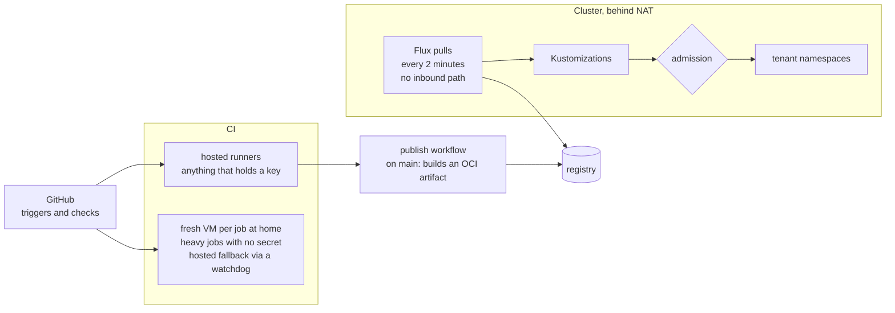
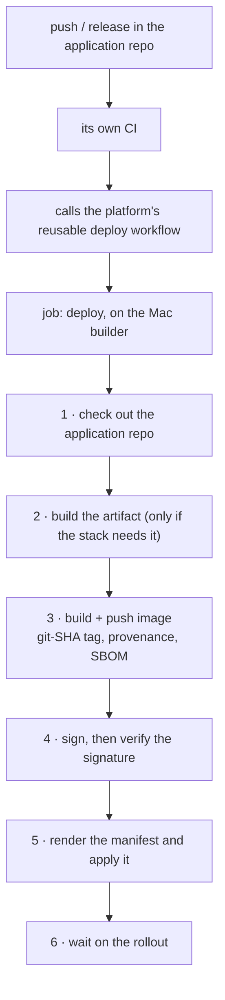
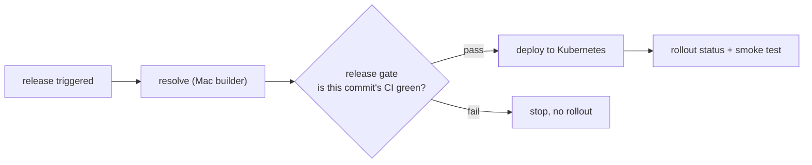

# The delivery chain



An application does not have to live in the platform's repository to run on it. It meets a
contract, and the platform checks that contract instead of trusting it. This page describes the
platform as it stands on 2026-11-11: a new cluster, brought up on 2026-11-10 and 2026-11-11 after
the previous one was torn down, so it is about 13 hours old as this is written. Every new claim
carries a date and a status: **proven** (a record or a live check shows it), **built-not-proven**,
**planned** or **open**. Material about V1.0 is kept, dated, in sections marked
*V1.0*. Measured counts for the new cluster are on the [generated stats](status.md)
page as that page's measurement catches up; anything not measured there is "not measured yet" here too.

---

## Why the cluster pulls

*History, kept because the reasoning still holds. Written 2026-08 to 2026-10, on V1.0.*

The house internet connection is behind carrier-grade NAT: no port forward, and no inbound
path for GitHub to reach the image registry or the Kubernetes API server. So a build running in
GitHub's cloud cannot push a deploy to the cluster. On V1.0 that was answered by
running every job on my own machines. A billing gap ended the cloud half in August 2026 (hosted jobs
were refused from 2026-08-15 because the account had no payment method), and by 2026-08-26 the last
hosted job had moved to a self-hosted runner. The CGNAT story was true; the billing gap is what made it total.

**That reasoning is exactly why the new cluster pulls.** If nothing can reach in, the cluster reaches
out: it fetches what to run from the registry on a timer. The pipeline therefore needs no route into
the house and holds no cluster credential. Proven in use 2026-11-10/11.

---

## How a change reaches the cluster

*New platform, state on 2026-11-11. V1.0's staged plan is further down, under [its four stages](#v10s-four-stages-to-2026-11-10).*

Images are built in CI, signed there with a key only the main branch can use, pushed to the
registry and pulled from it; admission checks them when a pod is created. The pipeline holds no
credential for the cluster.

**The path (proven 2026-11-10/11).**

1. A pull request, with required checks.
2. A squash merge into main.
3. A publish workflow builds an artifact from main and pushes it to the registry.
4. Flux on the cluster polls the source every 2 minutes; each Kustomization re-applies every 5 minutes, with pruning on. The live count of Kustomizations and their state is on the [status page](status.md); a number written here would go stale.

**Hand patches do not stay (seen live 2026-11-10).** When a tenant's quota was patched by hand, Flux
put it back within minutes. That is the old rule, "git is the only way in", now enforced by a
controller instead of a daily diff.

**Secrets** are per-namespace encrypted units, split out after the first bring-up deadlocked on
a single secrets unit that had to exist before the thing that decrypts it (built, applied 2026-11-10; the
deadlock itself was recorded on the day).

**Open, stated plainly (2026-11-11):**

- **The artifact is not signed, and Flux verifies nothing on it.** It is read through a moving tag.
  Anyone who could push that tag could change what the cluster runs. Signing and pinning it is the
  stated next step; only the application images are signed today.
- **Helm-chart software is not reconciled.** Operators, ingress, the admission engine, certificate
  management and the database operator are installed by the bootstrap script (read 2026-11-11: it runs the chart installs itself), because the site runs no
  Helm controller. They are in git but not held there by a controller. Open.
- **Default-deny has a gap at pod start (probed live 2026-11-10, recorded as a failed probe).** For about 1 to 3 seconds after a pod starts, its egress and ingress are open; after that the rules hold. Not tested: egress from the first packet under another engine, ingress from outside the cluster, DNS limits. Open.
- **Keycloak runs in its dev profile on an in-memory database** (seen by the same probe, 2026-11-10), so it loses state on a restart. Open.
- **Monitoring is built, not proven, on the new cluster (read 2026-11-11 07:00 UTC).** The monitoring tenant was merged into the private repository on 2026-11-11; its first live run failed on a missing namespace in the node exporter manifests, and a one-line fix for a missing namespace in the node exporter manifests landed the same day. At 07:00 UTC on 2026-11-11 all 19 Kustomizations were Ready, the metrics, alert, dashboard and state-metrics pods had been Running for under ten minutes, and the node exporter ran on all six machines. That is built, not proven: no scrape target, alert rule or dashboard has been read, and no alert reaches a person, so alert and
  dashboard figures are not measured yet. Built, not proven.

---

## The contract an application must meet

*New platform, built 2026-11-09 to 2026-11-10; the namespace rules are applied on the real site, the
rest as noted.* The platform provides the tenant namespace, the registry, the signing chain, ingress,
storage, identity and tracing. The application brings an image and a manifest, and meets an **app
standard**, which a manifest checker tests before a merge (built; the checker runs in the gate below).

What the tenant pack enforces:

| Rule | What it does | Status 2026-11-11 |
|---|---|---|
| Pod Security `restricted` | A container that runs as root, or asks for privilege, is refused at creation. | built, applied |
| Default-deny network policy | Nothing in or out except three allows: DNS, same-namespace traffic, and one combined outbound 443 plus tracing-port allow. Anything else is written per app. | steady state proven on the live site 2026-11-10; **fails for about 1 to 3 s after a pod starts** (recorded as a failed probe); ingress from outside and DNS limits not tested |
| ResourceQuota and LimitRange | Each tenant has a ceiling and per-container defaults. | built, applied; the quota was patched by hand once and reverted by Flux |
| Resource limits, probes, budgets | The manifest checker fails a manifest without them. | built, checked in CI |
| Image signature | A first-party image must carry the CI signature. | covers one named first-party image. Policy Ready with action Deny, and first-party pods running in an enforcing namespace (live check 2026-11-11); no record shows the signature check itself. Proven on a throwaway local cluster 2026-11-07 |
| Vendor images | A closed list, each pinned by digest. | a separate digest-pin policy, Ready; refused an off-list image on the real site 2026-11-10 (in the day's history, not a gate record) |

**"Nothing enforces them" is no longer true.** V1.0 shipped limits, probes and a
budget in a template and checked none of them; here the namespace and admission refuse what breaks the
rules, and the checker catches the rest before merge. That the checker and admission agree on every
case is not proven; the tenant-rights faults found on 2026-11-09 were fixed one by one.

**Vendor images are an open gap against our own rule.** The rule says images are admitted by signature.
Vendor images are not signed by this platform; they pass because a reviewer put their digest on a list.
That trusts the digest as pinned on a reviewed pull request, nothing more. Open.

---

## What a deploy actually does

*New platform, proven 2026-11-10/11.* There is no deploy job. A merge publishes an artifact and Flux
applies it. The tag-versus-digest question is better than before: workloads are identified by
content, not by a tag that a rollout could silently re-resolve, though the artifact itself is still read
through a moving tag (open, above). Rolling out from git on merge, which V1.0 listed as
not built, exists.

---

## The gate

*New platform, 2026-11-10.*

- **A kind gate on pull requests that touch the reference app:** the app is deployed onto a throwaway
  local cluster running the same tenant pack and admission, and exercised there.
- **Contract fuzzing** against the app's OpenAPI description, in the same gate.
- **An aggregate check, `ci-gate`, left out of the required checks until the watchdog recovers by itself.** Proof B, run on a throwaway branch pattern, 2026-11-10: after a
  watchdog fallback, a red aggregate result won over a green run, and the pull request stayed blocked 28 minutes
  after a green run existed. On main the same block is expected but not shown; main's required checks are two others. Keeping `ci-gate` out is the intended way to avoid a stale aggregate holding a merge, not a proven result.

---

## Where CI runs

*New platform, 2026-11-11.*

- **Mac runners were retired on 2026-11-10.** Two Ubuntu home CI builder hosts replace them, each an old (2013) desktop-class machine with about 15 GB of RAM. Each host runs one job VM at a time, fresh per job, behind an allow-list proxy, with no secret inside it. Both took jobs in parallel for the first time on 2026-11-11; those gates were started when I wrote this and have not finished, so parallel running is not yet proven.
- **Jobs that hold a key stay on hosted runners.**
- **Proof C, a throwaway pull request, 2026-11-10:** the full kind gate passed at home on
  attempt 3, after two red runs that were flakes of the gate itself, in 32 minutes 20 seconds. Once.
- **First real pull request, 2026-11-10:** the kind gate passed at home in one run, 33 minutes 12 seconds, with the old runners still active beside it; about 25 hosted minutes saved. Once; neither result shows it holds every time.
- **The case is saved Actions minutes, not speed:** about 33 minutes at home against 24 to 27 hosted.
- **Why now:** by day nine of November the included hosted minutes (3,000) were about 90 percent used: 89.5 percent by my own tally, 92 by the budget tool, a different figure (measured 2026-11-09). A $20
  budget was set on 2026-11-09; whether it stops spend at $20 is not verified. A hosted gate costs roughly $0.15 (an estimate: about 25 minutes at $0.006, not measured). Spend guards are merged.
- **Not proven:** a per-host heartbeat is merged but was not applied to both hosts on 2026-11-10, so I do
  not claim the two hosts share load or that failover between them works.

---

## Supply chain

*New platform, 2026-11-11.*

- **Own images** are signed in CI with a key that only main can use. The signature is checked at admission:
  **proven on a throwaway local cluster on 2026-11-07**; the real site has the same policy Ready since
  2026-11-10, a live check on 2026-11-11 shows it Ready with action Deny, the warn namespace set to enforce, and first-party pods running, which points to admission by signature having happened, but no record verifies it. It covers one named first-party image.
- **Vendor images** are admitted by a closed list plus a digest pin, checked by a separate policy (Ready), not by signature. Open, see above.
- **No vulnerability tracker or SBOM store runs now.** Planned. V1.0's counts are not carried over.
- **Not signed:** the delivery artifact (open).

One lesson holds regardless of the cluster: **a vulnerability scanner only matches what it can
identify.** An SBOM whose components carry only generic package identifiers produces zero
findings even when real vulnerabilities exist. Zero findings and "nothing was evaluated" look
identical on a dashboard. Check that components resolve to real ecosystem identifiers before
believing a clean report. The [embedded side](yocto.md) is where that was learned.

---

## The satellite, as history

*V1.0, dated 2026-08-11 to 2026-10-09.* Kept because its lesson still stands.

A contract that has only ever been exercised from inside the repository that defines it is
not a contract, it is a coincidence. So one application lives in **its own repository**
and deploys onto the platform by calling the published workflow.

It is deliberately tiny: a single endpoint that returns a line of text, no database, no
identity integration. **That is the design.** The variable under test is the contract, not
the application. Its own CI is only the call to the platform's workflow; it has no tests and
no dependency automation.

It was validated end to end on 2026-08-11, 1 minute 46 seconds from push to two healthy pods. As of
2026-10-09 it is **not running**: it has no deployment in the cluster. Nothing in the
platform repository calls the published contract (`deploy-app.yml`) any more, so the
contract has no live caller. The three reference apps deploy through a separate, gated
workflow, `cd-deploy.yml`. I have not redeployed the satellite since.

What it declares in its manifest is not tiny, and that is the interesting part. None of this
is checked by the platform (verified 2026-10-09 by reading the deploy workflow):

| Declared | Value |
|---|---|
| Replicas | 2 |
| Topology spread | `maxSkew: 1` over hostname, **`DoNotSchedule`**, so one node cannot hold both |
| Disruption budget | at least one replica always available |
| Resources | CPU, memory **and ephemeral storage**, requests and limits both |
| Probes | liveness and readiness on separate schedules, with distinct initial delays |
| Shutdown | a pre-stop delay so the load balancer drains first, then a framework-level graceful shutdown, inside a termination grace period long enough for both |
| API access | service account token mounting **switched off**; it never talks to the cluster API |

The shutdown chain is the detail most often missed. Removing a pod from a Service and killing
it are asynchronous events, so a pod that exits *promptly* on the signal drops the in-flight
requests still being routed to it. The delay is the difference between a rolling update being
invisible and being a small burst of errors every deploy.

### What the contract does not ask, and why that matters

This is a design lesson rather than a bug report. The satellite's manifest declares **no
pod-level security context**: no non-root assertion, no read-only root filesystem, no
`allowPrivilegeEscalation: false`, no dropped capabilities.

I used to write that it "inherits a non-root user from its base image and is fine in
practice". **That was wrong.** Its Dockerfile has no `USER` line, and as far as I could tell
(I did not re-check the base image's published config today) the base image sets none
either, so the container runs as root. Nothing checked, because the contract never asked.

Everything the *repository* owned was whatever that repository chose.

> **A platform contract silently defines the floor for everything built on it.** What it
> omits is not neutral. It is a permission, and it will be taken.

Both gaps are stated rather than papered over, because the fix is a genuine trade-off:
tightening the contract raises the floor for every satellite and simultaneously raises the
cost of being one. The current position is a deliberate choice for a small estate, and it
would be the wrong one at ten teams.

**Update 2026-11-11:** the new tenant pack makes this exact case refuse to start. Pod Security `restricted`
rejects a container that runs as root, so the floor is now set by the platform and not by what the
contract forgot to say. Whether a satellite repository can meet the new pack has not been tried (not proven).

---

## V1.0 (retired 2026-11-10)

*Everything below describes the platform torn down on 2026-11-10, with values measured between
2026-10-09 and 2026-10-27 on the old repository. None of it is current.*

### Why every job ran on my own machines

At 2026-10-27, 77 `runs-on:` lines in the workflow files were self-hosted and none GitHub-hosted. The
label counts below were re-counted on 2026-10-27:

| Runner label | `runs-on:` lines | What ran there |
|---|---|---|
| Linux builders | 29 | most CI, scans, DAST and jobs that need containers or service sidecars |
| Mac builder | 45 | the deploy, image scans and the registry/signing/`kubectl` work, the mobile CI, and light application CI |
| Mac gate pool | 2 | only the 90-minute release gate, on three dedicated runner instances |
| One Linux builder, picked by its own label | 1 | the nightly mutation-testing run |

The weakness was plain: the deploy ran on a single Mac builder. Every deploy, including the satellite
repositories that called in, stopped when it was off. It was the one part of the delivery path with no
redundancy, and there was no cloud fallback.

### Contract and deploy workflow

A satellite shipped by bringing a `Dockerfile` for `linux/amd64` and a manifest whose image line was a
placeholder (`${IMAGE}`, `${APP}`, `${NS}` were the only substitutions), and calling the published
reusable workflow. It was validated end to end on 2026-08-11 in 1 minute 46 seconds, and by 2026-10-09
nothing in the repository called it any more. The template shipped resource limits, a probe and a
disruption budget, but the deploy ran `envsubst` and `kubectl apply` and checked none of them.

Two deploy workflows exist, and this page used to blur them. The **ungated** one,
`deploy-app.yml`, is the published contract for satellites, and the diagram below is its
path. The **gated** one, `cd-deploy.yml`, is used by the three reference apps and is
described in the next section.

Step 3: **the deployed tag is the git SHA.** A floating tag would let a rollout pull a cached
older layer and report success. A `:latest` alias is pushed next to it, but nothing deploys
it, so "what is actually running" stays answerable.

Step 4: **the signature is verified, not just created.** Signing something and never
checking the signature is a ceremony, not a control.

### The old release gate

Three applications, the reference apps, go through a release gate between resolving the
release and deploying it. That gate lives in the gated workflow, `cd-deploy.yml`, and exactly
three workflows call it, counted 2026-10-09. The platform's other apps do not pass through
it, and none of them use the ungated satellite contract either.

The gate blocks on a red test suite. Health, vulnerability and code-quality signals are
reported but advisory, by decision rather than by omission. The old Swarm branch still
exists, but Swarm is retired and it runs only on a manual dispatch.

**Satellite repositories do not pass through the gate at all.** The ungated satellite
workflow (`deploy-app.yml`) is a single job with no policy step, so a satellite's own CI is the only thing
between a commit and a rollout. That is a deliberate consequence of keeping the contract
small, and an asymmetry worth knowing when deciding what belongs in a satellite versus the
platform itself.

### V1.0's four stages, to 2026-11-10

*Added 2026-10-27, from a decision made on the 24th.* The rule was: *git is the only way a change reaches the cluster.*

**It reopened a decision, and the reopen-trigger had fired.** On 2026-08-10 a pull-based
reconciler (Argo CD, Flux) was rejected on principle: it solves multi-team drift, which a
one-maintainer estate does not have, and rebuild-from-git was already proven by a drill. The
[choices page](choices.html#the-worked-example-argocd-and-flux-a-reopened-decision) wrote down when to reopen it:
*manifests are ever observed drifting from git*. They were, repeatedly, and each time with a cost:

- a retention setting that lived only on the live object for 19 days after a SEV1;
- four hand-applied monitors lost in a rebuild, one of which had silently disabled storage alerts;
- ten log-ruler values and an alert rule committed but not applied for days;
- unpinned application manifests rolled back by the next deploy;
- an installer that dropped a flag and brought a second default storage class back;
- and on 2026-10-21 a deploy that pinned a new image in git and a second deploy two minutes later
  that rolled the cluster *back* to the old one, where it stayed for two days.

**What was measured before choosing.** Every hand-run step was classified (about 172 make targets and 59
playbooks; the published split sums to 173). 104 are checks, drills and status views, which are not state at all; 24 are host-level
automation; 20 are imperative orchestration; 6 are wrappers; **19 are declarative applies a controller
could own.** On the same day, of about 80 plain manifests, 74 matched the live cluster and 6 did not (the published counts sum to 80, not 81; not re-checkable now).

**Four stages, each useful on its own, as planned and as they stood on 2026-10-27:**

| Stage | What | State on 2026-10-27 |
|---|---|---|
| 1. Detect | A read-only diff of every plain manifest against the live cluster, daily, with an alert on any difference. About three seconds. Deliberate exceptions carry a reason and an expiry. | **Done 2026-10-24.** It found 6 differences on its first run and all were resolved the same day. Three files are excluded with dated reasons that force a decision by 2026-12-01. |
| 2. Secrets in git | SOPS with age, two recipients (an operator key and a recovery key); a check fails any new plaintext Secret. | **Done 2026-10-25** for all 14 Secrets. **Open:** rotating the old values, which stay in git history, starting with the object-store root credential. |
| 3. Roll out from git | The declarative half applied on merge (19 steps), by a reconciler (Flux by default) or by CI. | **Not built on V1.0.** *Done on the new platform on 2026-11-10: see above.* |
| 4. Imperative steps | Realm setup, database major-upgrade scripts, bootstrap and key jobs, turned into idempotent jobs case by case. | **Not started.** |

**It reaches beyond the cluster.** The machine that runs the operations agent is not in the
cluster, and it is the one place where an unreviewed change matters most (it can act on the
cluster after a click). It now follows the same rule: the deploy exports a merged commit instead
of copying a working directory, stamps it, and a daily check compares the host with git.

**What this does not give.** There is no continuous reconciliation: a hand edit is caught by the
next daily run, not instantly. The diff sees plain manifests, not Helm releases (a separate check
covers those). And the rule is one person's discipline plus guards, because the plan cannot enforce
review. A related lesson from 2026-10-20: a rollout writes the new image tag into the manifest and
re-applies every application manifest, so an app shipped from a scratch checkout without committing
its pin is rolled back by the next deploy. Two services were, for about 100 minutes, until the pin
was committed.

---

## Read next

- **[DevSecOps, end to end](devsecops.md)**: every gate from commit to running pod, and what each proves. *V1.0 until rewritten.*
- **[High availability, audited](reliability.md)**: which failure domains survive losing a machine. *V1.0 until rewritten.*
- **[The operations agent](aiops.md)**: what a local model may change on a cluster without asking. *V1.0 until rewritten.*
- **[The embedded side](yocto.md)**: from zero findings to a hundred raw matches on one image.

---

Machines, addresses, hostnames and topology are deliberately absent. This page was
written for publication, not scrubbed after the fact.

