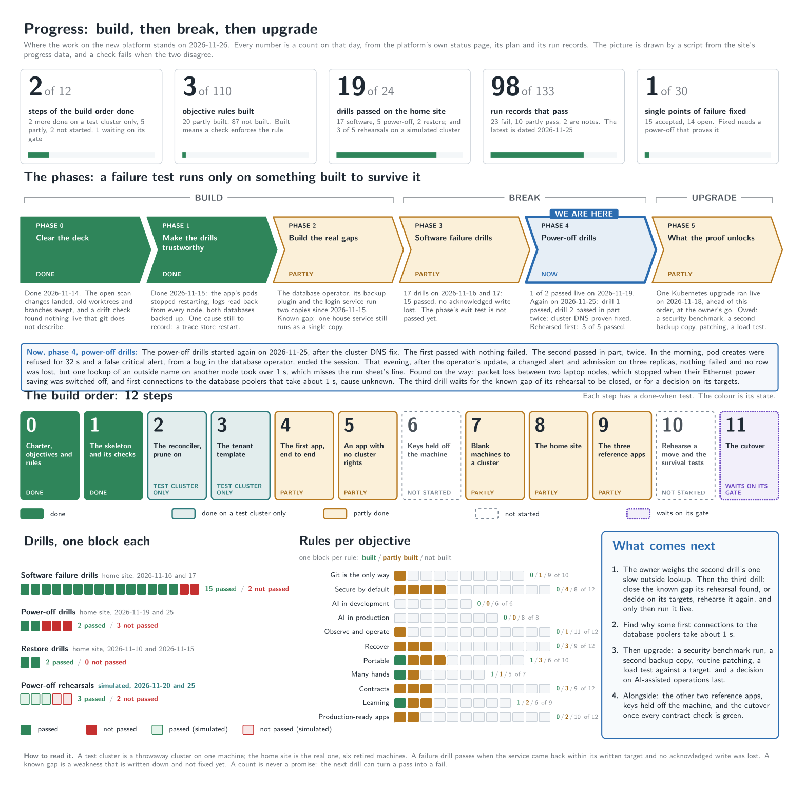




# Progress



**As of {{ p.as_of }}.** Every number on this page is a count on that day. It was copied by hand from the private platform
repository's generated status page, its plan and its run records, into
[one data file](https://github.com/schultzzznet/schultzzznet/blob/main/docs/_data/progress.yml). The page and the picture
are both drawn from that file, so they cannot disagree. A guard fails the build when the file's sums do not add up, when
the picture was drawn from other data, or when the file is more than three weeks old. The figures that [Status](status.html)
also shows are measured there by a script, on their own date. Where the two dates differ, the numbers may differ too.

This page shows where the work stands. It is not a promise of dates: the plan sets no dates for the phases or the cutover, and the next drill can turn a
pass into a fail.

## The picture

[The PDF](assets/diagrams/progress.pdf) zooms and prints. The drawing is
[progress.tex](assets/diagrams/progress.tex), and its numbers come from the data file by
[a script](https://github.com/schultzzznet/schultzzznet/blob/main/scripts/build-progress.py).

## Build, then break, then upgrade

The work runs in three parts and six phases. **Build** comes first, so that a failure test runs only on something built to
survive it. **Break** is the drills, software first, then power-offs. **Upgrade** comes last, so that a rolling upgrade runs
only on a cluster that has been shown to survive a node going away. One Kubernetes upgrade ran ahead of this order, on 2026-11-18, at
the owner's go; the phase table says so.

| Phase | Part | State | Where it stands |
| --- | --- | --- | --- |
| {{ x.number }}. {{ x.title }} | {{ x.group }} | **now**partly donenot started{{ x.state }} | {{ x.note }} |


**Now.** {{ p.now }}

## The counts

| What | Count on {{ p.as_of }} | What it counts |
| --- | --- | --- |
| Steps of the build order | {{ c.steps_done }} of {{ c.steps_total }} done | {{ c.steps_done_on_kind }} more are done on a test cluster only, {{ c.steps_partly }} partly, {{ c.steps_not_started }} not started and {{ c.steps_gated }} waits on its gate. Each step has a written done-when test, and a step is done only when that test passes. |
| Objective rules | {{ c.rules_built }} of {{ c.rules_total }} built | {{ c.rules_partly }} partly built, {{ c.rules_not_built }} not built. The rules sit under eleven objectives, and each names the check that would show it is met. Built means a check enforces the rule, not that it has held for long. |
| Run records | {{ c.records_pass }} of {{ c.records }} pass | {{ c.records_fail }} fail, {{ c.records_partial }} pass in part and {{ c.records_note }} are notes (a reading, no test). A record is written each time a test or drill runs and its result matters. A failure is kept when it taught something, and a record is never edited to change its result. The latest is dated {{ c.records_latest }}. |
| Single points of failure | {{ c.single_points_fixed }} of {{ c.single_points }} fixed | {{ c.single_points_accepted }} accepted and {{ c.single_points_open }} open. A point counts as fixed only after a drill has powered off the machine that held it and the service went on. |

## Drills

Each drill is one test, run once and written up as a record.

| Kind | Where | When | Run | Passed | What it is |
| --- | --- | --- | --- | --- | --- |
| {{ x.kind }} | home sitesimulated cluster | {{ x.dates }} | {{ x.run }} | {{ x.passed }} | {{ x.what }} |


A failure drill passes when the service came back within its written target and no acknowledged write was lost. The
simulated cluster is shaped like home, with three servers and three agents. A rehearsal there does not count as proof for
the home site: real network cards, the firewall and the old laptops' speed can change the timing. Its job is to find a
fault before the live drill does. The results up to 2026-11-20, drill by drill, are on [Reliability](reliability.html).

## The build order

Twelve steps, each with a written done-when test.

| Step | What | State |
| --- | --- | --- |
| {{ s.number }} | {{ s.title }} | done on a test cluster onlypartly donenot startedwaits on its gate{{ s.state }} |


A test cluster is a throwaway cluster on one machine. The home site is the real one, on six retired machines. A step done
on a test cluster only has its test passing there, not yet on the home site.

## What comes next

{{ forloop.index }}. {{ x.text }}


## How this page is kept honest

- **Counts, not targets.** Every figure is a count on the day named at the top. Nothing here is an estimate or a goal.
- **One source.** The page and the picture read the same data file, and the picture carries a digest of the data it was
  drawn from. The guard fails when the digest does not match.
- **A date that can go stale.** The guard fails when the data file is more than three weeks old. It also fails when the
  generated status figures were measured later than the file and disagree with it.
- **Sums that must add up.** The steps by state must add up to the steps, the rules per objective to the rules, and the
  records by result to the records. Any count typed in the summary at the top must be a count of the file.
- **What is left out on purpose:** plan items, machine names, addresses and software versions. An open weakness appears
  only as a known gap. The detail stays in the private repository; the trace from each number to its source line is
  recorded in the pull request that changed it.
