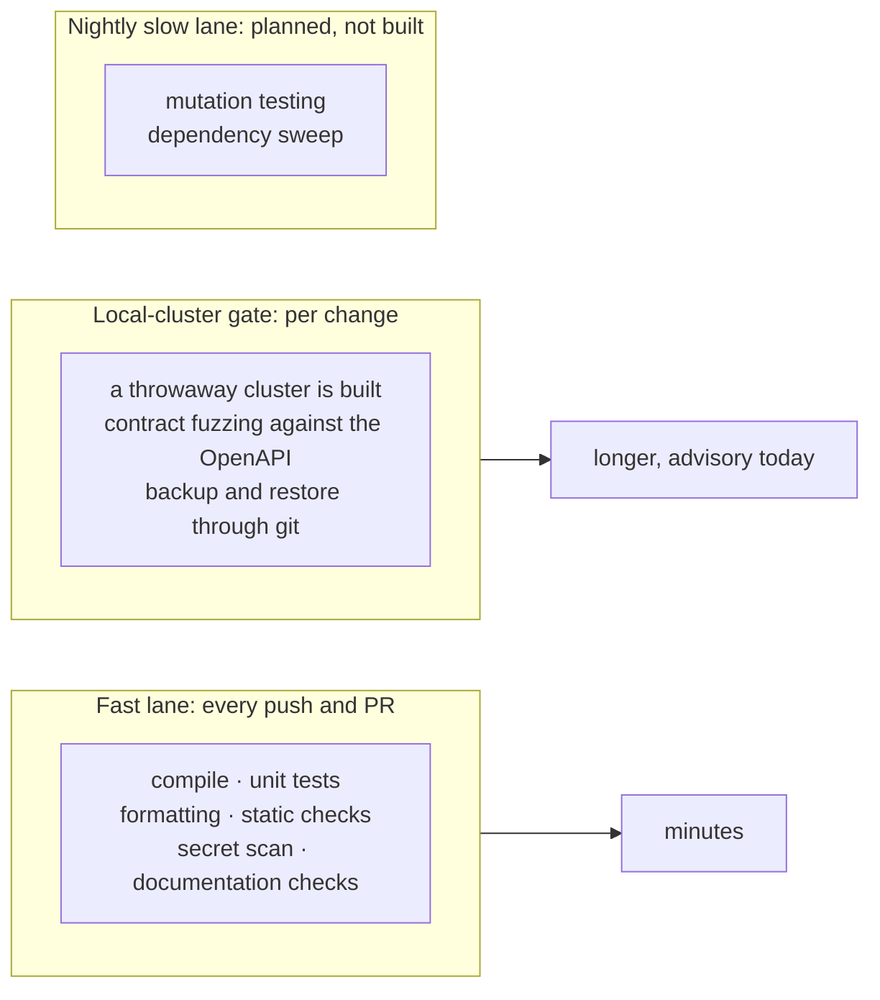
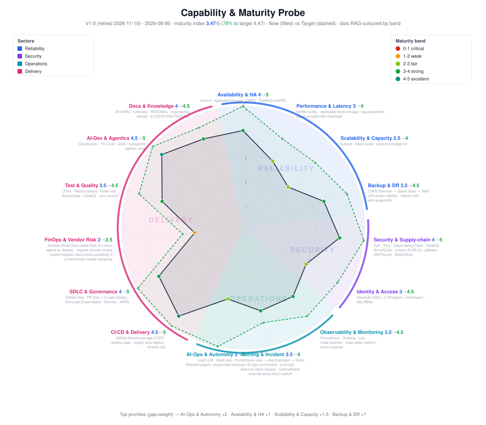
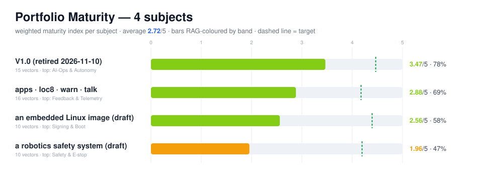



# What actually gates a merge, and how the platform scores itself



A gate nobody can fail is decoration. This page is the other side of
[the security gate table](devsecops.md): what stops a merge for a *quality* reason, what only
advises, and, because a platform that measures everything else and exempts itself would be
worth less than one that doesn't, how it scores its own maturity, weaknesses included.

**Which platform this page describes.** On 2026-11-10 V1.0 was torn down and a new one was brought up in a new repository (about a day before this page was re-read, 2026-11-11). Statements about the new one carry a date and a status word: *proven*, *built*, *planned* or *open* (defined once on [how we work](how-we-work.html)). Everything from before is under a heading that says **V1.0**, with its own date, and is never presented as current. The generated counts of the new repository's decision records, run records, workflow files and test methods are **not measured yet** (the stats are being regenerated against the new platform; [how figures are measured](status.md)). The register in the maturity section below is the only count used here.

---

## What stops a merge: the new platform (read 2026-11-08, proved on a throwaway branch; aggregate-gate finding 2026-11-10)

Unlike V1.0, **the server now refuses**. Read from the hosting API on 2026-11-08 and shown on a throwaway branch:

- a **pull request is required** to change main, with **two named checks** required to pass (the main check job and an objectives-line check) and the branch must be up to date with main;
- **zero approvals** are required (one maintainer), but **administrators are bound** by every rule, including the owner;
- **history is linear**, and squash is the only merge method;
- there is **no merge queue**.

**Only two checks are required: the main check job and the objectives-line check.** An aggregate gate job exists. It runs always and fails if any check it needs failed, was cancelled or did not run. It is **not a required check**. A test on 2026-11-10 ("proof B") found why it cannot simply be switched on: after a runner fallback one commit carries two results, a red one from the cancelled run and a green one from the re-dispatched run, and the **red result wins**, so the pull request stays blocked until the original run is re-run in full. The watchdog has to change first. The aggregate gate is deliberately not required yet; the fix is **open** (2026-11-11).

**The consequence, stated plainly.** The local-cluster gate (which carries the contract fuzzing), the app build and test, and the aggregate gate are **advisory**. A red test in the reference app, or a broken manifest the required checks do not cover, can still be merged on green required checks. The aggregate gate is deliberately not required yet, with the fix open; the local-cluster gate and the app checks are advisory, and I have not yet decided whether to require them.

**The result in practice (2026-11-11):** 76 of the first 77 commits, in the first six days of the repository, went through a pull request. Status: **proven** on 2026-11-08 for the rules as read; not seen over time, because six days is not a track record.

**V1.0 (until 2026-11-10).** Branch protection could not be enforced on that repository's hosting plan (the API refused the request, checked 2026-10-09), so "blocking" meant red by convention and nothing on the server stopped a direct push. That was a weaker thing than a gate, and this page had said "blocks" unqualified until the 2026-10-09 retraction. The new repository is in a different position, which is why the rule above exists at all.

---

## Two speeds, on purpose

The split exists because the thorough version of some checks is too slow to run on
every commit without destroying the feedback loop that makes small, frequent changes safe.
The idea survives the move: a fast lane on every push, a heavier gate on a throwaway local cluster, and a slow lane for what is too expensive for either. **The slow lane does not exist yet.** Status, 2026-11-11: **mutation testing and the nightly dependency sweep are not on the new repository (planned)**.

**V1.0 (until 2026-11-10), kept as history.** Mutation testing ran nightly against per-app floors of 25, 35 and 35%, never blocked a pull request, and the job was red on six of the last eight scheduled nights as of 2026-10-09 (the recorded scores were 28, 37 and 39%, dated 2026-08-26). Coverage on a read of the old dashboard on 2026-08-10 had one service at 44.7% and clearing its gate and the one at 67.6% failing, on new-code rules: the gate working as designed. None of those figures describe the new platform, and **the new reference application's own test suite has not been counted in them**. Its coverage is **not measured yet**.

---

## The contract-testing story, and the trap inside it

Every backend publishes an OpenAPI specification, and a property-based tester throws
generated, spec-legal inputs at the *running* service and checks the response matches what
the spec promises, not just that the endpoint returns something.

**On the new platform (2026-11-10 move review):** contract fuzzing against the reference app's OpenAPI document is part of the local-cluster gate, which is advisory (see above). When the fuzz was added (about 2026-11-07 to 2026-11-08) it **found eight real faults** in the reference app's contract, and they were fixed. One further fault, a repeated query parameter that the contract forbids but the app accepts, was found in a later CI run on 2026-11-08 and is **open** with no owner. Status: **proven** (2026-11-08) to find faults; whether eight is most of them is unknown. That is the value of the exercise: a hand-written specification describes intent, and a service under generated input shows what it does.

**V1.0 (2026-09 to 2026-10), the instructive part.** The first real run there had 132 documented operations and 496 conformance findings, 8 of them server errors. Precisely zero operations carried an explicit response-code annotation, so every response type was auto-derived from a method signature, which only describes the success path. Most findings were the tool correctly saying *"you never told me this endpoint could return this,"* not defects. That is a trap with a wrong exit and a right one:

- **The wrong fix** is annotating every documented status code until the tool stops complaining, which launders a handful of real defects into a sea of newly "documented" ones and teaches the next reader that the noisy baseline was always normal.
- **The right fix** is annotating the small number of shared exception-handler classes that produce the error responses, which fixes the specification for every endpoint behind them and leaves the genuine defects visible.

The lesson was carried to the new gate: read what a finding says before counting it.

---

## Load, autoscaling, and the difference between reacting and deciding

**Status, 2026-11-11: there is no load generator on the new platform** (V1.0's in-cluster generator went with it), so no load figure exists and none is claimed. Autoscaling is horizontal pod autoscaling on CPU: 2 autoscalers exist (cluster DNS and the reference app, read from the API 2026-11-11), reacting to CPU only. Nobody has loaded them to see that they scale, so the status is **built**.

**Progressive delivery is the other side of the same honesty.** Deployments are a plain rolling update. **Rollback now means a git revert**: the in-cluster reconciler (Flux, installed since 2026-11-10) puts back whatever git says, so a hand-run rollout undo would be reverted by the reconciler. That is a cleaner rule than V1.0's, where a manual rollback did not touch git and the next deploy would reinstate the bad version; it is also less drilled: a revert through git was shown on a local cluster before the real one, and **not yet exercised on a live failure**. **Blue/green and canary rollout with automatic analysis are not built.**

**Chaos (2026-11-11):** failure injection was tried in a **spike on a local cluster only**. There is **no scheduled injection** on the real platform. Status: **planned**.

---

## A gap closed by refusing to close it

Not every open item on the roadmap is a thing waiting to be built. One of the more useful
entries was a **rejection**.

A cluster-state reconciler that continuously re-applies the git-declared state was evaluated and turned down on 2026-08-10 **on principle, not deferred**, because the problems it solves (several teams stepping on each other's changes, pull-based reconciliation across many operators) did not exist at single-maintainer scale. The rejection carried its own reopen condition, written down: **a second maintainer arriving, or configuration observed drifting in practice.** The second half was met more than once (pin drift on 2026-09-29, a DNS deployment disagreeing with git on 2026-10-03), and the decision was reopened on 24 October 2026.

**Outcome, 2026-11-10: the Flux decision is made and Flux is installed.** It runs on the new platform, pull-based, with prune on, and the 2026-12-01 decision date was met early. The history stays because the lesson is unchanged: a decision without a stated trigger to revisit it is procrastination wearing a decision's clothes, and a trigger that fires without anyone looking is not much better. Status: **built**, and reconciling since 2026-11-10; the live Ready count changes with every merge, so it is on [the status page](status.html) and not here. The one failure I saw on 2026-11-11 was the new monitoring tenant (see the gaps below). See [the choices page](choices.html#the-worked-example-argocd-and-flux-a-reopened-decision).

---

## Assertions that the documentation is not lying

Documentation rots silently. Nothing errors when a diagram describes a topology that changed
six weeks ago, and the person best placed to notice is the one who already believes the
diagram.

**V1.0 (until 2026-11-10):** a single command lived in the old repository that re-derived claims from the live system (inventory against the node list, pinned versions against what was running, the public-edge allowlist, four scheduled jobs). Its last recorded count on 2026-10-09 was 49 assertions with 48 holding. That command did not move.

**On the new platform (2026-11-11):** documentation is asserted against the inventory by **check scripts** run in the pull-request checks, and a **generated status page** states what the checks found. Status: **built**; the checks are days old and have not yet caught a lie that a person did not find first, so they are not yet seen to be good at it.

One check on V1.0 is worth describing, because building it taught more than running it. The
delivery pipeline signed every image and verified the signature before deploying, but nothing checked whether the images **actually running right now** were signed. Four lessons fell out, and they apply to the new checks too:

**Verify the thing, not the label.** The obvious implementation verifies the image tag. A tag can be overwritten, so that proves something about whatever it points to *now*. The check resolved each container's actual digest and verified that.

**A check that has never failed is not known to work.** It was mutation-tested: pointed at the wrong signing key to confirm everything was reported unsigned, then pointed back. Both directions, or it is decoration.

**An inert check is worse than an absent one.** If the tool or the key is missing, the check *fails loudly* rather than skipping. A green line that means "I didn't look" is indistinguishable from one that means "I looked and it's fine".

**The first result was wrong, and reporting it would have caused a fire drill.** The initial run said every first-party image was unsigned: a tooling default demanded a public transparency-log entry that offline key-based signing never produces. **Reading the actual error instead of the exit code was the difference between a correct finding and an alarming false one.**

---

## Grading our own maturity: the new platform

The new platform is **not scored on the old ladder**. It is scored against its own objectives and key results, and **that page is still a draft with no start date**, so there is no headline index to publish and none is invented. What exists is a generated register, the 2026-11-10 status file (written the evening before the 2026-11-11 merges, so it can lag them), that counts what has actually been done:

| Register | Count | Breakdown |
|---|---|---|
| Plan steps | 12 | 2 done, 2 done on a local cluster only, 5 partly, 2 not started, 1 gated |
| Rules (the written-down requirements) | 109 | 3 built, 19 partly, 87 not built |
| Run records | 35 | 26 pass |

Read honestly: **the platform is early.** Three of 109 rules are fully built, and most of what the earlier pages call "built" is a first version, a day or a week old. Of the 35 run records, 26 pass; the other nine did not pass, and are counted rather than hidden. The December 2026 re-grade was the previous repository's plan and does not apply: **no dated re-grade of the new platform is scheduled until the objectives page has a start date** (open).

---

## Self-grades of V1.0 (2026-08-06 to 2026-10-18)

Everything below graded V1.0 and its sibling subjects. **None of it is the new platform's score.** It stays, dated, because a score you can revise silently is not a measurement, and because the shape of it (which rows were weak) is the best account of what the new platform was built to fix.

Two independent scoring systems ran: a **narrative ladder**, five levels from ad hoc to elite, scored per domain with the evidence in prose, and a **weighted capability radar**, a small purpose-built, dependency-free Python tool scored 0 to 5 against a stated target.

### The narrative ladder, graded 2026-09-09

`L3` is the bar a paid public product must clear; `L4` is elite and only worth reaching where the domain is core to the product's identity or risk. **The target column is deliberately not `L4` everywhere.**

| # | Domain | Current | Target | Trend |
|---|---|:---:|:---:|:---:|
| 1 | Engineering foundations | **L3** | L3 | ↑ |
| 2 | CI/CD & delivery | **L3** | L4 | → |
| 3 | Reliability & SRE | **L3** | L4 | ↑ |
| 4 | Observability & telemetry | **L3** | L3 | ↑ |
| 5 | **Security & supply chain** | **L4** | L4 | → |
| 6 | Data & privacy engineering | **L1** | L3 | → |
| 7 | Legal & regulatory | **L1** | L3 | → |
| 8 | Mobile & app-store ops | **L2** | L3 | → |
| 9 | **Product analytics & feedback** | **L0** | L3 | → |
| 10 | **UX quality** (accessibility, i18n, performance) | **L0–L1** | L3 | → |
| 11 | Governance & org-scale | **L2** | L2 | → |
| 12 | Business continuity / FinOps / vendor risk | **L2** | L2 | ↑ |

The infrastructure and operations half crossed the baseline; the product-facing half did not. Analytics was at zero, UX barely off the floor, legal at `L1` against `L3`. A maturity model that grades you green everywhere is measuring the wrong things, or is being read by its author. The three earlier ladder grades were 2026-06-05, 2026-07-31 and 2026-09-09.

> **A second opinion on the security row, 2026-10-18 (V1.0).** An outside review of the whole estate
> graded security and supply chain **3 of 5** on its own scale (not this ladder): the supply chain
> was elite for a homelab, but the application-security and in-cluster layers were baseline, with a report-only habit that had not been broken and no admission layer or network policies. Both numbers were self-generated
> (the reviewer is an AI model); the evidence behind each, not the digit, is the part to weigh. **Two of those findings, the missing admission layer and the missing network policies, are closed on the new platform (2026-11-10 and 2026-11-11, built, about a day old); the report-only habit is not re-measured.**

### The radar, assessment dated 2026-08-06

The tool reads one assessment file (plain JSON: weighted capability *vectors*, each with a score, a target and the evidence behind both) and renders an SVG radar, a Markdown scorecard and, given two dated assessments, a diff. **The output is generated from one file in git**, so a scorecard six months old and one from today are diffable text, not two screenshots.

*Caption: this radar is V1.0's self-grade, dated 2026-08-06, kept as history. It is not the new platform's score.*

On that snapshot V1.0's weighted index was 3.47 of 5, against a target of 4.47, 78% of the way there. The shape mattered more than the average:

| Strongest | Score | Weakest | Score |
|---|---|---|---|
| CI/CD & delivery | 4.5 | FinOps & vendor risk | 2.0 |
| AI-native development | 4.5 | Scalability & capacity | 2.5 |
| Security & supply chain | 4.0 | **AI operations & autonomy** | **3.0, largest gap to target** |
| Availability & HA, SDLC, docs | 4.0 | Identity & access, performance | 3.0 |

### The portfolio, regenerated 2026-09-28

The same tool scored the wider portfolio, rolled up into one comparison.

*Caption: V1.0's portfolio roll-up, dated 2026-09-28. Two of the other three assessments were still marked draft from July 2026.*

The scoring was deliberately conservative, crediting only what was deployed and verified. The tool does not know or care what it grades: the same schema scored a Kubernetes platform, the application layer on it, an embedded Linux image and an unrelated robotics safety system. **A capability-maturity tool that only works on the thing it was written for isn't a tool, it's a spreadsheet with extra steps.**

---

## Honest gaps

Status as of 2026-11-11, on the new platform unless stated.

- **Mutation testing and the dependency sweep do not exist** on the new repository (planned). V1.0 had them as advisory jobs.
- **The aggregate gate job is deliberately not a required check yet**, and neither are the local-cluster gate or the app build and test (advisory). Proof B (2026-11-10) found that a red result from a cancelled run wins over a green re-run; the fix is open. Branch protection itself is proven only for the rules as read.
- **Rollback is a git revert**, shown on a local cluster, not yet used on a live failure. Blue/green and canary are not built.
- **No load generator**, so no capacity figure; autoscaling is built.
- **Tracing is built.** A trace backend runs; no trace has been read, and the collector is not deployed. The monitoring tenant that would show metrics, alerts and dashboards was merged on 2026-11-11. Its first live run (2026-11-11) failed on a missing-namespace defect in the node exporter manifests, the fix landed the same day, and at 07:00 UTC its pods were Running. Nothing from it has been read, so the alert-rule and dashboard counts are not measured yet; no alert rules or dashboards exist to count.
- **Admission is enforced, not yet fully tested.** The earlier gap, "signing is verified in the pipeline, not at admission", is **no longer true**: admission rules run in Deny mode since 2026-11-10. What is not shown is a negative test for every rule.
- **The rebuild was by playbook, in order, with a person watching.** It was not a hands-off rebuild, and has been done once on real hardware. The local rehearsal on a throwaway cluster covers **one distribution only**, so a result from it says little about the differences between the real machines.
- **Backups are one copy** on one small machine; a restore drill passed once on 2026-11-10.
- **No client-side crash reporting**, unchanged.
- **Identity runs in a development mode** (2026-11-11): good enough for a reference app, not a production claim.

---

## Read next

- **[DevSecOps, end to end](devsecops.md)**: the security half of the gate table this page's
  quality half sits beside.
- **[AI in development](ai-dev.md)**: the same no-exemption principle applied to who, or
  what, proposed the change in the first place.
- **[High availability, audited](reliability.md)**: where the rollout and failover claims in
  this page are exercised for real, not just described.
- **[Live status](status.md)**: the counted figures, with the command that produced each.

---

Written for publication. Machines, addresses, hostnames and credential locations are
absent by construction and enforced by a guard that fails the build.

